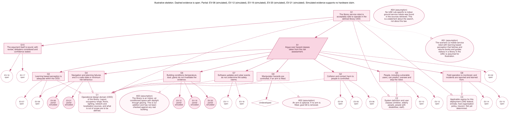

# 0. Read this first

**What this is.** A structured, source traced study of what robot, drone and autonomy standards and regulations ask a developer to *produce as evidence* before deployment, which of those asks are binding, and where they are silent. It is built from 222 evidence table rows (`data/evidence_table.csv`), each tied to a URL a research subagent or I retrieved on 11 or 12 October 2026. This second edition adds a fresh verification of every row and official source checks (section 2.3 and section 9).

**What this is not.** It is not certification advice and not legal advice. Several instruments are paywalled; for those the table says "title and scope only" or "summary seen" and no clause content is claimed.

**How to read the two voices.** Statements of what a document says are written plainly and carry row IDs such as (A04) that point to the table. My own interpretation is always set in a block starting **Reading (interpretation):** so you can strip it out and defend only the documented part.

**Three caveats that matter before you share anything.**

1. The web fetch tool used for most retrieval returns *model written extractions* of pages, not raw text. "Full text seen" therefore means the specific passage was returned and read, not that a human read the original PDF. Verifiers downloaded some PDFs directly (SORA 2.5, the EASA annex, GCAA CARs, SACE, the Federal Register NPRM), but the EUR-Lex text of Regulation 2023/1230 and the AI Act articles were read only through extractions or an unofficial reproduction.
2. The AI Act article rows come from artificialintelligenceact.eu, an unofficial reproduction. Rows relying on it were downgraded to "summary seen" and should be checked against the Official Journal.
3. Verification (section 2.3) found real errors, and the final check after correction still flagged a substantial share of rows. 28 rows carry text taken from one final reading only (labelled `single checked` in the table).

# 1. Executive summary

**Question.** Across robot and drone safety standards and regulations, what evidence must a developer produce before deploying autonomous or semi autonomous machines in workplaces and public spaces; what is mandatory; and where are the gaps, particularly for learning based autonomy and Gulf conditions?

**Headline findings** (each is supported in sections 4 to 7; interpretation is flagged there).

1. **Very little robot specific evidence is mandatory, and what is mandatory is mostly legal process rather than technical acceptance criteria.** The binding rows are mainly the EU Machinery Regulation (technical file, conformity assessment, declaration and marking, retention for 10 years) (A03 to A05), the EU drone regulations (authorisation, declaration, registration) (C01 to C10), and UAE drone rules (product conformity in C48; the GCAA operator rules, C51 to C54, are now recorded as title and scope only because their text could not be re read in the second edition). The robot safety standards themselves (ISO 12100, ISO 10218, ISO 13482, ISO 3691-4, IEC 61508, ISO 13849, UL 3300) are voluntary in law; they become relevant through the harmonised standard route to a presumption of conformity (A07) or through contracts and market expectations.
2. **A single evidence skeleton recurs everywhere:** a defined operating context, a documented hazard and risk assessment, verification and validation records, a technical file, a declaration or independent assessment, operating procedures, logging, and incident reporting. What differs is who checks it and how rigorously.
3. **Learning based autonomy is the least standardised area.** The EU Machinery Regulation makes machine learning safety functions a category needing third party assessment (A16, secondary source for the annex wording), the AI Act sets high level duties on risk management, data governance and robustness (B20, B21, B26), but the technical standards that would make these testable were still being written (A21, B33), and the road vehicle standards (ISO 21448 and relatives) do not by their scope cover robots (B01, B02). The most concrete guidance (AMLAS, SACE, MLEAP) is non binding (B44, B46, D21).
4. **No instrument I could retrieve asks a developer to test against Gulf heat, dust, sun glare or GNSS jamming/spoofing.** The closest hooks are generic: SORA operational safety objectives on environmental qualification (D35, D38), Dubai's autonomous vehicle rules requiring tests under local climatic conditions (secondary source, no numbers) (D50, C65), generic IEC test methods (D62, D63), and GNSS interference operational guidance (D52 and others). This is an absence finding within the scope searched, not proof that nothing exists.
5. **UAE position.** For drones the UAE has a findable, structured regime (Federal Decree-Law 26/2022, Cabinet Resolution 110/2023 on products, GCAA CAR-UAC/CAR-UAEX for operators) (C47 to C56). For ground robots, no UAE rule specific to service or delivery robots was found; Dubai's autonomous vehicle law and RTA resolution cover vehicles on roads (C64, C65). What governs an indoor library robot in the UAE is therefore **unresolved by the sources found** and is the first open item in the worked example.
6. **Simulation is accepted as evidence in several places but never as a free standing credit.** SORA guidance allows it if the target environment is justified (D38), UL 4600 expects a mix of analysis, simulation, closed course and road testing (B07), NASA-STD-7009 offers a credibility scale (D27, secondary), and AMLAS asks for evidence that the simulator represents reality (B45). No source gave a quantitative rule for how much simulation can replace physical testing.

**Verification error rate.** A fresh, independent check of all 222 rows by two separate sets of new verifiers (passes A and B) flagged at least one problem in a key column (paraphrase, binding status or access level) in 32.0 percent (71 of 222; 95 percent interval 26.2 to 38.4) of rows when either verifier objected, and 14.4 percent (32 of 222; 95 percent interval 10.4 to 19.6) when both did. Phase 1 had reported 13 percent content errors in a 30 row sample. After correction, a third set of verifiers (pass C) still flagged 32.9 percent (25 of 76; 95 percent interval 23.4 to 44.1) of the changed rows (22.4 percent when rows the fetch tool could not read are excluded) and 20.0 percent (6 of 30; 95 percent interval 9.5 to 37.3) of a 30 row sample of unchanged rows. The prediction written beforehand (under 10 and under 8 percent) was not met. 28 rows were corrected from the final reading alone and are labelled single checked. Details in section 2.3.

# 2. Method

## 2.1 Protocol (written before research; `docs/PROTOCOL.md`)

- **Inclusion.** Instruments named in the brief; a row is admitted only if it is a testable requirement or evidence expectation visible in a retrieved source.
- **Search.** Four independent streams, run in parallel by research subagents: (A) machinery and robot safety, (B) autonomy and AI, (C) drones and the UAE, (D) assurance practice and Gulf conditions. For each instrument: official catalogue or status page first, then regulator or open text, then public summaries; record what could not be accessed. UAE searches were run in English and Arabic.
- **How "required" is decided.** *Mandatory*: binding legal text on the developer or operator, seen in legal text or an official regulator page. *Conditional*: binding only if a trigger holds (risk class, category, harmonised standard route, approval pathway). *Voluntary*: not referenced by law in the relevant jurisdiction. *Guidance*: regulator or body guidance, non binding. A standard that is voluntary in law but gives a presumption of conformity under a regulation is recorded as conditional, with the route stated.
- **Access levels.** *Full text seen* (the cited passage was read), *summary seen* (abstract, official summary, secondary or unofficial reproduction), *title only* (catalogue entry and scope; no requirement content asserted).
- **Paywalls.** Never reproduced or reconstructed. Clause numbers recorded only if seen in a retrieved source.

## 2.2 Resulting table

222 rows. Binding status after verification: mandatory 43, conditional 56, voluntary 48, guidance 75. Access level after verification: full text seen 41, summary seen 167, title only 14. Verification status: confirmed by final check 52, corrected after final check, single checked 28, verified three times 26, verified twice, no change 116.

The original columns (instrument, edition or version, status note, clause seen, paraphrased requirement, binding status, applies to, evidence type, who verifies, source URL, retrieval date, access level, notes) are in the CSV together with derived columns: `family`, `evidence_codes` (section 5), and from the second edition `clause_reported_unverified` (a locator a source reported but that no verifier could confirm in full text), `binding_checked`, `verification_status` and `last_checked`. A clause locator sits in `clause_or_section_seen` only when the access level is full text seen and a verifier saw it. Appendix A shows a compact version; the CSV is authoritative.

**Row duplication.** Some provisions appear in more than one stream (for example Machinery Regulation rows in streams A, B and D, and EASA's AI concept paper in streams B and C). I did not delete them because the verifiers checked them independently, but counts by instrument overstate the number of distinct requirements.

## 2.3 Verification (second edition)

**Why.** The first edition found 13 percent content errors in a 30 row sample (21 of 30 rows had an issue of any kind) and the corrections were never re checked. The second edition repeats verification on all 222 rows with different subagents, and measures the rate before and after correction. The plan, the reconciliation rules and the predictions were written before the runs (`data/verification/PLAN.md`); the frozen inputs are hashed in `data/verification/outcome.json`.

**Design.** Official source updates were applied first (91 field changes, `data/official/applied_changes.csv`) and the table was frozen. Pass A and pass B each checked every row with new subagents, blind to each other, to earlier verdicts and to the notes column, with different batch boundaries. For each row a verifier recorded, from its own retrieval: whether the paraphrase is supported, the locator it actually saw, the binding status it would assign, and the access level its reading supports. Reconciliation was mechanical: access level takes the lower of the two readings; a binding status changes only if both agree on a new value; a paraphrase is replaced by the flagging verifier's text; a clause locator stays in `clause_or_section_seen` only if the final access level is full text seen and a verifier saw it, otherwise it moves to `clause_reported_unverified`. Pass C then checked all 76 rows that changed in a key column plus 30 unchanged rows (seed 20261012).

**Error rates before correction (passes A and B on the frozen table, n = 222).**

| Measure | Pass A | Pass B | Both flag | Either flags |
|---|---|---|---|---|
| Paraphrase issue | 16.7% | 15.3% | 11.7% | 20.3% |
| Binding status differs | 3.2% | 4.1% | 1.8% | 5.4% |
| Access level overclaimed | 13.5% | 7.7% | 6.3% | 14.9% |
| Any key column (row error) | 26.1% | 20.3% | 14.4% | 32.0% |

Agreement between A and B: binding status 96.4 percent (Cohen's kappa 0.951); access level 85.1 percent (kappa 0.669). The access level was also underclaimed in 7.7 percent of rows by at least one verifier; those were not raised, by rule. Row error "either" has a 95 percent interval of 26.2 to 38.4 percent.

**Error rates after correction (pass C).**

| Group | Rows | Row error | Excluding rows the fetch tool could not read | Paraphrase issue | Binding differs |
|---|---|---|---|---|---|
| Changed rows | 76 | 32.9% | 22.4% | 27.6% | 5.3% |
| Unchanged sample | 30 | 20.0% | 20.0% | 13.3% | 6.7% |

**Predictions written beforehand and how they fared.** fresh row error either 15 to 35: observed 32.0% (inside); paraphrase issue 8 to 20: observed 20.3% either (just above); 11.7% by both; access overclaim 8 to 20: observed 14.9% either (inside); binding disagreement 5 to 15: observed 5.4% either (inside, lower edge); passC changed rows under 10: missed: 32.9% (22.4% excluding tool limited unverifiable rows); passC unchanged sample under 8: missed: 20.0%; binding agreement 85: met: 96.4% raw, kappa 0.951.

**What the rows look like now.** Access level: full text seen 41, summary seen 167, title only 14 (the first edition had 70 full text seen). No row was removed; rows that could not be supported by a retrieved source were set to title only with title and scope text. Verification status: confirmed by final check 52, corrected after final check, single checked 28, verified three times 26, verified twice, no change 116. Every change is in `data/verification_changelog_v2.csv` with its stage and reason.

**How to read these numbers.** The third check flagged more detail problems (recital versus operative text, scope claims in status notes, truncated extractions) than the first two, so the corrected table is better but not clean. The after correction figure is not lower than the before figure and I do not claim it is. All verifiers used the same fetch tools, so agreement is not ground truth. Rows corrected from the final reading alone (28) have not been checked twice. The most useful next step is a human read of the rows you intend to quote, against the source.

# 3. The landscape: what each instrument is, and how binding it is

Statuses are as seen in retrieved sources on 11 October 2026; "unverified" means I could not retrieve a source that settles it.

| Instrument | Edition / status seen | Binding for a developer | Notes |
|---|---|---|---|
| EU Machinery Regulation (EU) 2023/1230 | Applies from 20 January 2027. The 14 January 2027 on one Parliament page is the uncorrected print date (corrigendum OJ L 169, 4.7.2023, p. 35). Directive 2006/42/EC applies until then (B35). See section 9, items M01 to M04 | Mandatory in the EU (A03 to A06) | Annex I Part A, Annex III and Annex IV text were not reached in an official source; Annex content is from secondary sources (A16 to A19) |
| ISO 12100 | 2010 edition; ISO page shows it due for revision | Voluntary in law; conditional via harmonised standard route (A22, A07) | Harmonised list evidence is the 2021 list under the old Directive; current citation under 2023/1230 not checked |
| ISO 10218-1 / -2 | 2025 editions published (A23, A25) | Conditional (route) or voluntary; EN harmonisation of 2025 editions unverified (A26) | ISO/TS 15066: ISO says it is to be replaced; vendor pages say its content moved into ISO 10218:2025. Sources conflict |
| ISO 13482 | 2014; due for revision (A28) | Voluntary / conditional via the old harmonised list | Abstract notes no recognised impact injury data existed at publication (A29) |
| ISO 3691-4 | 2023 edition; 2020 edition withdrawn (A31) | Voluntary | Scope excludes public zones; clause text not read (D64) |
| IEC 61508; ISO 13849-1/-2 | IEC 61508 (2010 edition) current; ISO 13849-1:2023 current; -2:2012 | Voluntary / conditional (A32 to A36) | Catalogue and abstracts only |
| UL 3300 | Listed as ANSI/CAN/UL 3300:2025 with a 2024 publication date (labels conflict) (D66) | Voluntary; third party evaluation at developer or market request (A37) | Edition not confirmed |
| UL 3115 | Outline of Investigation, not a full standard (B12) | Voluntary | Meant to be used with a product standard such as UL 3300 |
| ISO 21448 (SOTIF) | 2022; under revision (B01) | Voluntary | Road vehicle scope; applicability to robots is interpretation (B02) |
| UL 4600 | Edition 3, March 2023 (B06, D04) | Voluntary | Generic autonomy standard; requires a safety case; catalogue and news text only |
| EU AI Act (2024/1689) as amended by Regulation (EU) 2026/1744 | Amending regulation dated 8 July 2026, in force 27 July 2026 (official service pages); high risk obligations from 2 Dec 2027 (Annex III systems) and 2 Aug 2028 (Annex I systems) per a recital and a Commission page. The amending article itself was not reached (section 9, AI07) (B17, B18) | Conditional (high risk classification) | Text from unofficial reproduction; robots mostly reach the Act through machinery legislation (B19, interpretation) |
| Harmonised standards for the AI Act (CEN-CENELEC JTC 21) | EN 18286 (quality management) approved; risk, data and cybersecurity standards still drafts per mid-2026 pages (B33) | Voluntary; presumption of conformity once cited | Date of citation in the Official Journal disputed between sources |
| EU Reg. 2019/947 and 2019/945 | In force; the retrieved text is the original unamended act (C01 to C14) | Mandatory in the EU | |
| JARUS SORA 2.5 | Main body dated 13 May 2024 (C15 to C26) | Guidance in itself; EASA adopted it as AMC (C28 to C36) | EASA amendment labelled 3 on the PDF and 4 on the web page (conflict) |
| FAA Part 107, Part 89 | Current rules (C39 to C43) | Mandatory in the US | Part 108 BVLOS rule: proposed rule retrieved; final rule status rests on secondary blogs (C44 to C46) |
| UAE drones | Federal Decree-Law 26/2022; Cabinet Resolution 110/2023; GCAA CAR-UAC Issue 02 and CAR-UAEX Issue 02 (titles only in this edition; limits not read again), CAR-UAR Issue 04 (C47 to C58) | Mandatory in the UAE | A GCAA U-space rule is reported only by news (C60) |
| UAE ground autonomy | Dubai Law 9/2023 and RTA Administrative Resolution 939/2025 (autonomous vehicles on roads, including autonomous equipment and machinery categories) (C64, C65); Abu Dhabi permits for L4 vehicles by press release only (C66) | Mandatory in Dubai for covered vehicles | No rule for service or delivery robots found |

**Reading (interpretation).** For a developer in the UAE the legally binding layer is thin and drone heavy. The technical weight sits in voluntary standards and in expectations of buyers, insurers and regulators. Which binding regime applies to a given robot depends on where it operates and whether it is exported: the EU instruments matter if the product is placed on the EU market, not by virtue of being built in the UAE.

# 4. What the evidence table shows

## 4.1 The recurring evidence set

Reading the rows together, the same artefacts recur across instruments:

- **Defined operating context.** SORA's ConOps and SAIL determination (C17, C21), BSI PAS 1883 and ISO 34503 ODD taxonomies (D11, D13), SACE's first stage (B46), UL 4600's safety case tied to the ODD (D05), the Machinery Regulation's requirement to account for the intended operating area of autonomous mobile machinery (A19, secondary).
- **Hazard and risk assessment record.** ISO 12100 as the generic method (A22), ISO 13482 and ISO 3691-4 as type-C style applications (A28, A31), EU AI Act Article 9 for AI systems (B20), SORA's ground risk steps (C18, C19).
- **Technical file and declaration.** Machinery Regulation Article 10: documentation, conformity assessment, EU declaration, CE marking, retention for 10 years, source code or logic on request (A03 to A05).
- **Verification and validation records.** ISO 13849 requires a validation plan and report (A36), IEC 61508 a safety lifecycle with hardware and software records (A32 to A34), AI Act Article 15 accuracy and robustness evidence (B26).
- **Independent assessment.** Notified body routes under the Machinery Regulation (A11, A16), SORA's third party verification at higher assurance levels (C16, C29), EASA design verification reports at SAIL IV and type certificates at SAIL V to VI (C31), UL's optional third party evaluation (A37).
- **Operating procedures, instructions and oversight.** AI Act Articles 13 and 14 (B24, B25), SORA operational safety objectives on procedures and training (C34), UL 3300's user classes and surroundings (A38).
- **Logging and monitoring.** AI Act Article 12 (B23), Machinery Regulation Annex III retention of safety decision data (A18, secondary and with an unverified anchor), AMLAS deployment monitoring (B45), runtime monitor research (D24, D25).
- **Incident reporting and field feedback.** AI Act Articles 72 and 73 (B29, B30), EU occurrence reporting (D44), GCAA CAAP 22 reporting categories and times (D45), FAA Part 107.9 (D48), UL 4600's safety performance indicators with field feedback (B08 to B10).

## 4.2 Mandatory versus voluntary: the shape of the table

| Instrument family | Rows | Mandatory | Conditional | Voluntary | Guidance |
|---|---|---|---|---|---|
| EU Machinery Regulation 2023/1230 | 26 | 11 | 14 | 0 | 1 |
| ISO 12100 | 1 | 0 | 1 | 0 | 0 |
| ISO 10218 / TS 15066 | 5 | 0 | 3 | 2 | 0 |
| ISO 13482 | 3 | 0 | 0 | 2 | 1 |
| ISO 3691-4 | 2 | 0 | 0 | 2 | 0 |
| IEC 61508 | 3 | 0 | 0 | 3 | 0 |
| ISO 13849 | 2 | 0 | 2 | 0 | 0 |
| UL 3300 | 4 | 0 | 0 | 4 | 0 |
| SOTIF / road-vehicle AI-safety (ISO 21448 family) | 6 | 0 | 0 | 6 | 0 |
| UL 4600 | 8 | 0 | 0 | 8 | 0 |
| EU AI Act (+Omnibus, standards) | 25 | 2 | 22 | 0 | 1 |
| ISO/IEC AI standards (TR 5469 etc.) | 5 | 0 | 0 | 5 | 0 |
| Learning-enabled assurance guidance & research | 21 | 0 | 0 | 1 | 20 |
| EU drone regs 2019/947 & 945 | 14 | 8 | 6 | 0 | 0 |
| JARUS SORA 2.5 | 18 | 0 | 0 | 0 | 18 |
| EASA AMC/GM (SORA) | 11 | 0 | 0 | 0 | 11 |
| FAA (Part 107/89/108) | 10 | 5 | 0 | 0 | 5 |
| UAE rules (GCAA, MOIAT, Dubai RTA) | 28 | 15 | 3 | 1 | 9 |
| Safety-case notations & guidance | 5 | 0 | 0 | 3 | 2 |
| ODD standards | 5 | 0 | 0 | 5 | 0 |
| Simulation credit / ADS test standards | 8 | 0 | 4 | 3 | 1 |
| Incident reporting regimes (EU, US) | 2 | 2 | 0 | 0 | 0 |
| GNSS interference guidance | 7 | 0 | 1 | 0 | 6 |
| Environmental test standards (IEC 60529/60068/61496-3) | 3 | 0 | 0 | 3 | 0 |

**Reading (interpretation).** Mandatory rows cluster where a regulator controls market entry or operation (CE marking, drone authorisation, UAE operator approval). Technical depth lives in rows that are voluntary or guidance. A developer who only does what is mandatory will often have a process file but little technical evidence of safety.

# 5. Taxonomy of assurance evidence types (bottom up)

**How it was built.** Each row's `evidence_type` field was written by the researcher who read the source, in free text (for example "Third party testing/assessment leading to UL Mark", "Contingency volume calculation", "Triggering condition analysis (SOTIF style)"). I grouped those descriptions into 15 types by what the artefact is and what it is used for, merged near duplicates, and kept a separate bucket for rows that describe context rather than an artefact. The grouping used keyword rules, and verifiers then checked and corrected the codes of all 222 rows. A row can carry several codes. The taxonomy is therefore *derived from the table* but its boundaries are my judgement, not a standard.

| Evidence type | Rows | of which mandatory | conditional | voluntary | guidance |
|---|---|---|---|---|---|
| E00 No evidence artefact (context, scope or status note) | 35 | 5 | 3 | 12 | 15 |
| E01 Hazard / risk assessment record | 23 | 5 | 4 | 6 | 8 |
| E02 Scope, classification and operating-context definition (incl. ODD, ConOps) | 25 | 2 | 5 | 8 | 10 |
| E03 Technical documentation / technical file | 16 | 7 | 8 | 0 | 1 |
| E04 Design and safety-function verification (lifecycle, PL/SIL, design standard) | 25 | 0 | 13 | 7 | 5 |
| E05 Physical test and validation evidence (performance, robustness, environmental) | 30 | 2 | 14 | 7 | 7 |
| E06 Simulation / scenario-based and credibility evidence | 13 | 0 | 3 | 5 | 5 |
| E07 Data, learning-assurance and ML evidence | 12 | 0 | 3 | 0 | 9 |
| E08 Safety case / assurance argument | 29 | 0 | 2 | 12 | 15 |
| E09 Independent / third-party assessment or certification | 26 | 6 | 10 | 3 | 7 |
| E10 Declaration of conformity, marking, labelling | 18 | 7 | 4 | 0 | 7 |
| E11 Operating procedures, manuals, instructions, training, human oversight | 20 | 5 | 4 | 0 | 11 |
| E12 Logging, monitoring and data retention | 22 | 6 | 9 | 1 | 6 |
| E13 Incident / occurrence reporting and post-market monitoring | 24 | 6 | 6 | 3 | 9 |
| E14 Quality or safety management system | 12 | 1 | 7 | 1 | 3 |
| E15 Authorisation, registration, permit or approval | 28 | 17 | 4 | 0 | 7 |

**Definitions.**

- **E01 Hazard and risk assessment record.** Structured identification and estimation of hazards and risks, and the record of risk reduction (ISO 12100-style, AI Act Art. 9, SORA ground/air risk).
- **E02 Scope, classification and operating context definition.** Documents that fix what the system is, where and how it operates and which regime applies: ODD, ConOps, risk class or category determination, operational volume.
- **E03 Technical documentation or technical file.** The retained, structured dossier that makes the other evidence findable by an authority; may include source code or logic on request.
- **E04 Design and safety function verification.** Evidence that safety functions are specified and designed to a required integrity: performance level or SIL determination, lifecycle records, design standard compliance, system safety assessment.
- **E05 Physical test and validation evidence.** Results from tests on the real system or components: performance, robustness, contact force, environmental, stopping, interference.
- **E06 Simulation and scenario based evidence, with credibility.** Scenario sets, simulation results and the argument that the simulation is credible.
- **E07 Data, learning assurance and ML evidence.** Dataset specification and representativeness, model verification, triggering condition analysis, generalisation and runtime monitor evidence.
- **E08 Safety case or assurance argument.** A structured argument linking claims to evidence, with confidence or defeater analysis (GSN, UL 4600, SORA safety portfolio).
- **E09 Independent or third party assessment.** Notified body certificates, design verification reports, accredited lab test reports, third party evaluation marks.
- **E10 Declaration of conformity, marking and labelling.** The manufacturer's formal declaration, marks and labels.
- **E11 Operating procedures, instructions, training and human oversight.** Manuals, instructions for use, competency, supervision design, human machine interface evidence.
- **E12 Logging, monitoring and data retention.** Event logs, runtime monitoring, retained decision data, tracking.
- **E13 Incident and occurrence reporting, and post market monitoring.** Duties and artefacts for reporting events and feeding field data back.
- **E14 Quality or safety management system.** Organisational management systems (QMS, SMS, AI management system).
- **E15 Authorisation, registration, permit or approval.** Administrative permissions obtained from an authority.
- **E00 No evidence artefact.** Rows that record scope, status or legal context rather than something a developer produces.

# 6. Coverage matrix: instruments versus evidence types

Cell letters give the strongest binding status among the instrument family's rows that mention that evidence type: **M** mandatory, **C** conditional, **V** voluntary, **G** guidance. A blank means no row in that family asks for that type, *not* that the instrument forbids it.

| Instrument family | Rows | E00 | E01 | E02 | E03 | E04 | E05 | E06 | E07 | E08 | E09 | E10 | E11 | E12 | E13 | E14 | E15 |
|---|---|---|---|---|---|---|---|---|---|---|---|---|---|---|---|---|---|
| EU Machinery Regulation 2023/1230 | 26 | M | M | C | M | C | C |  | C |  | M | M |  | M |  | M | C |
| ISO 12100 | 1 |  | C |  |  |  |  |  |  |  |  |  |  |  |  |  |  |
| ISO 10218 / TS 15066 | 5 |  | C |  |  | C | C | C |  |  |  |  |  |  |  |  |  |
| ISO 13482 | 3 | G | V |  |  |  |  |  |  |  |  |  |  |  |  |  |  |
| ISO 3691-4 | 2 | V | V | V |  | V | V |  |  |  |  |  |  |  |  |  |  |
| IEC 61508 | 3 |  |  |  |  | V | V |  |  |  |  |  |  |  |  |  |  |
| ISO 13849 | 2 |  |  |  |  | C | C |  |  |  |  |  |  |  |  |  |  |
| UL 3300 | 4 | V | V | V |  |  |  |  |  |  | V |  |  |  |  |  |  |
| SOTIF / road-vehicle AI-safety (ISO 21448 family) | 6 | V | V |  |  | V | V | V |  |  |  |  |  |  |  |  |  |
| UL 4600 | 8 |  |  | V |  | V | V | V |  | V | V |  |  |  | V |  |  |
| EU AI Act (+Omnibus, standards) | 25 | M | C | C | C | C | C |  | C |  | C | C | C | C | C | C | C |
| ISO/IEC AI standards (TR 5469 etc.) | 5 | V |  |  |  |  |  |  |  |  |  |  |  |  |  | V |  |
| Learning-enabled assurance guidance & research | 21 | G | G | G |  |  | G | G | G | G |  |  |  | V |  |  |  |
| EU drone regs 2019/947 & 945 | 14 | C | M | M | M | C | C |  |  |  | C | M | M | M |  |  | M |
| JARUS SORA 2.5 | 18 | G | G | G |  | G | G | G |  | G | G | G | G |  |  |  |  |
| EASA AMC/GM (SORA) | 11 | G | G |  | G | G | G |  |  |  | G | G | G |  |  |  | G |
| FAA (Part 107/89/108) | 10 | G | G | G |  | G | G |  |  |  | G | M | G |  | M | G | M |
| UAE rules (GCAA, MOIAT, Dubai RTA) | 28 | V | M |  |  | C | M |  |  |  | M | M | M | M | M |  | M |
| Safety-case notations & guidance | 5 |  |  |  |  |  |  |  |  | V |  |  | G |  |  | G |  |
| ODD standards | 5 |  |  | V |  |  |  |  |  | V |  |  |  |  |  |  |  |
| Simulation credit / ADS test standards | 8 |  |  |  |  | C | C | C | C | C |  |  | C | C | C | C |  |
| Incident reporting regimes (EU, US) | 2 |  |  |  |  |  |  |  |  |  |  |  |  |  | M |  |  |
| GNSS interference guidance | 7 |  |  |  |  | G | C |  |  |  |  |  | G | G | G |  |  |
| Environmental test standards (IEC 60529/60068/61496-3) | 3 |  |  |  |  |  | V |  |  |  |  |  |  |  |  |  |  |

Column key: E01 risk assessment; E02 scope, ODD, classification; E03 technical file; E04 design and safety function verification; E05 physical test and validation; E06 simulation and credibility; E07 data and learning assurance; E08 safety case; E09 independent assessment; E10 declaration, marking; E11 procedures, instructions, oversight; E12 logging and monitoring; E13 incident reporting and post market; E14 quality or safety management system; E15 authorisation, registration, permit.

**How to read it.** The matrix shows what the rows record, not a legal test of what each instrument can require. Families are groupings I created, and a family's letter can be driven by a single row. In particular, "M" in the UAE family comes from drone rules and from Dubai's road vehicle rules; it does not indicate a mandatory evidence requirement for a robot.

**Reading (interpretation).**

- Apart from the UNECE ADS rule as reported by secondary sources (D31), only the EU Machinery Regulation and the AI Act carry a conditional ask for data and learning assurance evidence (E07); nothing is mandatory in the strict sense. Everything else on E07 is guidance.
- Simulation (E06) is asked for conditionally by the UNECE ADS rule as reported (D31, secondary) and recommended elsewhere, but nowhere mandatory for robots.
- E09 (independent assessment) is mandatory or conditional wherever market entry is controlled (machinery, drones, UAE operator approval) and optional in the standards.
- Incident reporting (E13) is the most consistently *binding* evidence type across jurisdictions (EU occurrence reporting, GCAA, FAA, AI Act).

# 7. Gap analysis

Each gap states what documents say, then my interpretation. UAE claims appear only where a retrieved source supports them.

## 7.1 Learning based perception and planning

**What documents say.**

- The Machinery Regulation treats safety components with fully or partially self evolving behaviour using machine learning as a higher scrutiny category needing third party assessment (A16, D43, secondary sources for the annex text; recitals 54 and 55 explain the intent (A15)). It also lets a software driven change count as a "substantial modification" only when it meets the Article 3(16) conditions (A06).
- The AI Act sets lifecycle risk management, data governance, logging, human oversight, and accuracy, robustness and cybersecurity duties (B20, B21, B23, B25, B26). It states what to document, not numerical acceptance thresholds. Application of the high risk obligations was deferred to 2027 and 2028 by the 2026 omnibus regulation (B17, B18).
- The Commission's standardisation request asks CEN-CENELEC for standards on machine learning safety functions, protection against corruption and autonomous mobile machinery, with a first deadline of 20 January 2026 (A21). Whether that deadline was met was not checked. Harmonised AI Act standards were largely drafts in mid-2026 (B33).
- ISO 21448, ISO 26262, ISO/PAS 8800 and ISO/TS 5083 are road vehicle documents by scope (B01, B02, B04, B05). ISO/IEC TR 5469:2024 is an informative report, not requirements (B38); ISO/IEC TS 22440 is still at committee draft (B39).
- The most concrete guidance is non binding: AMLAS gives a staged process with artefacts for ML safety requirements, data management, model learning, verification and deployment (B44, B45); SACE gives a system level eight stage process (B46); EASA's MLEAP report sets out learning assurance concerns on data completeness, generalisation and robustness (D21).
- Research on triggering conditions for perception and on learned runtime monitors exists but is early stage (D22 to D25). One monitor paper reports 92% accuracy on a simple traffic sign case and lists its own limitations (D25).

**Reading (interpretation).** Learning enabled components are the clearest *evidence gap*: legal text says "show it is robust and representative", the testable standard that defines how is mostly missing or in draft, and the usable method (AMLAS, SACE) is voluntary. A developer must therefore *choose and defend a method*, which is also an opportunity: a safety case built on AMLAS style data and verification arguments will be more convincing than one that only cites a standard.

## 7.2 Gulf conditions: heat, dust, glare, GNSS degradation

A proposal (not a result) for what a developer could test, argue and simulate for these four conditions is in `docs/GULF_TEST_PROTOCOL.md`. It cross references the author's dhill (heat and dust) and marsad (GNSS) projects without duplicating them.

**What documents say.**

- *Environmental qualification, generic.* SORA 2.5 operational safety objectives on environmental limits and qualification (#23 and #24); #24 is not required at SAIL I-II, medium at SAIL III and high at SAIL IV-VI (D35). The UK CAA's AMC says simulation may be used if the target environment is justified and gives DO-160 as an example standard (D38). The applicant defines the conditions; heat, dust and glare are not named.
- *ODD vocabulary.* BSI PAS 1883 lets an ODD declare airborne dust and sand and illumination attributes, with temperature only optional; it is a taxonomy, not a test requirement (D11, D12). ISO 34503 is a taxonomy and format for ODDs (D13).
- *Test methods.* IEC 60068-2-2 (dry heat) and IEC 60529 (IP code, referencing a dust and sand test method) are methods whose severities are chosen by a product standard or contract (D62, D63). The safety scanner standard IEC 61496-3:2025 states that it does not address outdoor application (D65). ISO 3691-4's contents list climatic condition and high temperature clauses, but the text was not read (D64).
- *Dubai.* Secondary sources say Dubai's autonomous vehicle rules require operational tests under local climatic conditions, with no numeric limits seen (D50, C65). RTA Resolution 939/2025 Article 3 is reported as requiring local operational test runs with data (C65).
- *GNSS.* EASA's AMC tells drone operators to identify GNSS as an external system and prepare procedures for complete GNSS loss and poor satellite geometry (C34); the text read contains no jamming or spoofing wording. EASA Safety Information Bulletin 2022-02R4 names the Middle East, not specifically the Persian Gulf, and is non mandatory (D52). UAE working papers submitted to ICAO document jamming and suspected spoofing and propose reporting frameworks (D57, D58, D59). GCAA reporting material lists interference affecting aircraft safety among safety critical events (D45, D46). ETSO-C146e (GNSS receivers) includes a spoofing section stated to create no new requirements, though other parts add requirements (D54).
- *UAE drone products.* Cabinet Resolution 110/2023 requires conformity testing of drone products, including a GPS feature test, geographic boundary identification and safe fall and return, with an Annex A standards list including IEC 61508 (C48 to C50).

**What was not found** (recorded as absence within the searched scope): no instrument read requires testing a robot or drone against a stated Gulf ambient temperature, solar loading, sand or dust storms or sun glare; no UAE regulation (GCAA, TDRA, ITC, RTA) was found that requires GNSS jamming or spoofing resilience testing; GCAA CAR-OCR text and a TDRA statement on GNSS interference were not found. IEC 60721 climatic classes, MIL-STD-810 and IEC 60204-1 were not retrieved and remain unverified.

**Reading (interpretation).** The Gulf is handled by *delegation*: standards ask the developer to define the conditions and qualify against them, and leave the choice of severity to the developer. That is a gap with a practical consequence: two products can both be "compliant" while one has been tested at 55 degrees C with dust loading and the other has not. A defensible UAE ready case should state the temperature, dust and glare envelope explicitly and test to it, and treat GNSS denial as a design assumption (with indoor deployment the issue becomes localisation robustness rather than GNSS).

## 7.3 Human robot interaction in public spaces

**What documents say.**

- ISO 3691-4's scope excludes public zones (A31), the 2025 ISO 10218-1 abstract excludes service robots where the public has access (A23), and the IEC 61496-3 safety scanner standard excludes outdoor application (D65).
- ISO 13482 covers personal care robots (mobile servant, physical assistant, person carrier), notes missing impact injury data at publication, and is due for revision (A28, A29).
- UL 3300 covers service, communication, information, education and entertainment robots in settings with people present, with user classes and use surroundings as evaluation inputs (A37, A38, D66). Only catalogue and article text was read.
- AI Act Article 14 requires oversight design so humans can understand limits, detect automation bias, override and stop (B25), and Article 13 requires instructions covering accuracy, oversight and maintenance (B24).
- For UAE ground robots in public spaces, no rule specific to delivery or service robots was found; Dubai pilots appear only in news (C67), and the autonomous vehicle instruments are about vehicles on roads (C64, C65).

**Reading (interpretation).** The standards were written for factories, vehicles and personal care contexts; a robot moving among unsupervised members of the public, including children and people with disabilities, sits on the boundaries of several scopes at once. The least binding but most relevant sources are UL 3300 and ISO 13482 as design references, and AI Act oversight articles as a vocabulary for human oversight evidence. What counts as an acceptable injury risk limit for a service robot is not settled in the sources I could read.

## 7.4 Simulation as evidence

**What documents say.**

- SORA related guidance allows simulation when the target environment is justified (D38). UL 4600 expects the safety case to show a mix of analysis, simulation, closed course and public road testing for the initial release and each software update (B07). SACE describes simulation as helping reviewers (Activity 3), as additional analysis to corroborate hazard validation (Activity 8) and as an option for validation (Note 13) (D20). AMLAS asks for evidence that the simulator represents reality when simulation is used for integration testing (B45).
- NASA-STD-7009 defines eight credibility factors scored 0 to 4 (D27, read through slides describing the 2008 version; voluntary). ISO 34502 is a scenario based evaluation process scoped to ADS on limited access highways (D29). A trade press report says a UNECE regulation for fully driverless systems accepts validated virtual environments as part of a safety case; the primary text was not retrieved (D31).
- A vendor page on ISO 10218 says contact force evidence for power and force limiting may come from measurement or validated simulation (A26); this is secondary.

**Reading (interpretation).** Simulation is accepted *as one leg of a mixed argument*, and always conditional on a credibility argument for the simulator and the scenario set. No retrieved source set a quantitative share of evidence that simulation may supply. For a small team, the defensible position is: simulate to explore and to cover rare scenarios, validate the simulator against physical tests in the ODD, and say so explicitly.

# 8. Worked example: assurance case skeleton for a library assistant service robot

**Scenario (assumed for illustration).** A mobile service robot with learning based perception and an optional arm that fetches and returns books and guides visitors in a library in the UAE. I made these assumptions; they are not facts about any particular project. **Every evidence item below is OPEN: no evidence is claimed to exist.** A machine checkable version of this case is `assurance/library_robot_case.yaml`; `tools/ac_check.py` flags open evidence, unsupported claims and untraced items, and `tools/ac_render.py` draws the diagram from the file. Items marked "decision needed" depend on choices the team has not recorded here.

**Evidence checklist.** "Motivating sources" are table row IDs that motivate asking for the item; they show *why the item is on the list*, not that any instrument requires it for this robot. Where I add an expectation not found in a source, it is marked "(my addition)".

| ID | Evidence item | Motivating sources | Status |
|---|---|---|---|
| EV-01 | ODD and system definition: library layout, occupancy ranges, user classes (children, elderly, people with disabilities, staff), floors and obstacles, lighting including daylight through glazing (my addition), network and localisation sources, what is out of scope | PAS 1883 and ISO 34503 taxonomies (D11, D13); SACE stage 1 (B46); AMLAS scoping (B44); UL 4600 completeness tied to ODD (D05); SORA ConOps (C17) | OPEN. Decision needed |
| EV-02 | Hazard and risk assessment, identifying hazardous situations for people, objects, and the robot's own failures | ISO 12100 method (A22); ISO 13482 scope for mobile servant robots (A28); ISO 3691-4 hazard annex as an analogue for mobile platforms (A31); UL 3300 scope (A37); AI Act Art. 9 as vocabulary (B20) | OPEN |
| EV-03 | Regime determination: which laws and authorities govern an indoor robot in the assumed building (UAE federal, emirate, host organisation policy, insurer); whether EU rules apply if exported | UAE sources found cover drones and road vehicles only (C47 to C56, C64, C65); Machinery Regulation scope (A01, B35); AI Act dates (B17) | OPEN. Not answerable from the sources found. Ask the relevant UAE authority and the host organisation |
| EV-04 | Safety requirements and safety function specification: speed and force limits, protective stop, emergency stop, safe states, with the integrity level (performance level or SIL) chosen and justified | ISO 13849 performance level evidence (A35); IEC 61508 lifecycle (A32 to A34); ISO 3691-4 control system verification (A31) | OPEN. Decision needed: target integrity level |
| EV-05 | Contact and collision evidence: measured contact forces and pressures for relevant body regions, with limits justified | ISO 10218 and PFL measurement or validated simulation, vendor page (A26); ISO 13482 abstract warns injury data were not available at publication (A29) | OPEN. Decision needed: what limits and from which source |
| EV-06 | Stopping distance and obstacle detection tests at maximum speed and in the worst ODD conditions | ISO 3691-4 verification scope (A31); ISO 13849 validation plan and report (A36) | OPEN |
| EV-07 | Perception evidence: dataset specification, coverage of ODD (people, wheelchairs, strollers, glass, reflective floors, glare), model verification, triggering condition analysis, performance in worst case lighting | AMLAS stages 2 to 5 (B44); dataset coverage argument (D18); triggering condition analysis (D22); MLEAP data completeness (D21); AI Act Art. 10 as vocabulary (B21) | OPEN |
| EV-08 | Planning and navigation safety: independent safety monitor or minimum risk strategy, behaviour on ODD exit, localisation loss handling | SACE out of context stage and minimum risk strategy (B46); UL 4600 ODD violation handling (B09); EASA GNSS loss procedures as a drone analogue only (C34) | OPEN |
| EV-09 | Simulation credibility: scenario library, simulator validation against physical tests, scenario coverage, documented limits | UL 4600 mix of evidence (B07); AMLAS simulator reality evidence (B45); SACE simulation roles (D20); NASA credibility scale (D27, secondary); SORA simulation justification (D38) | OPEN. Decision needed: credibility method |
| EV-10 | Human interaction evidence: signalling, predictability, stopping by staff and users, tests with representative user classes, escalation path | UL 3300 user classes and surroundings (A38); AI Act Art. 14 oversight and Art. 13 instructions as vocabulary (B24, B25) | OPEN |
| EV-11 | Cybersecurity and update control: who can change safety settings, how updates are re argued | ISO 10218-1:2025 cybersecurity to the-extent it affects-safety (A24, secondary); Machinery Regulation annex on protecting safety functions from alteration (A18, secondary); UL 4600 per update reargument (B07) | OPEN |
| EV-12 | Building condition evidence: temperature range of the space including HVAC failure, dust ingress, glare and daylight effects on sensors; enclosure protection level chosen and tested | IEC 60529 and IEC 60068-2-2 test methods (D62, D63); SORA environmental objectives as analogue (D35, D38); PAS 1883 environment attributes (D11, D12) | OPEN. Decision needed: the envelope and severities (nothing in the sources fixes them) |
| EV-13 | Operating procedures, staff training, supervision model, maintenance and instructions for use | AI Act Art. 13 as vocabulary (B24); SORA procedures objective as analogue (C34); UL 3300 evaluation inputs (A38) | OPEN |
| EV-14 | Logging and retention: what the robot records (near misses, stops, detection confidence), how long, privacy implications | AI Act Art. 12 as vocabulary (B23); retention of technical file and decision data (A05, A18); GCAA record keeping for drone operators as an analogue only (C52, title and scope only, not confirmed) | OPEN. Decision needed: retention period; privacy review (my addition) |
| EV-15 | Incident reporting and field monitoring: definitions, safety performance indicators, root cause process, reporting path to the host organisation and to any authority identified in EV-03 | UL 4600 SPIs and field feedback (B08 to B10); AI Act Arts. 72 and 73 (B29, B30); EU occurrence reporting (D44); no UAE ground robot reporting rule found | OPEN |
| EV-16 | The safety case document itself, in GSN or equivalent, with assumptions, confidence arguments and defeater analysis | GSN community standard (D01); UL 4600 safety case (B06); safety case templates (B47); defeaters (D09) | OPEN |
| EV-17 | Independent review: internal safety review at minimum; optional external evaluation (for example against UL 3300) | UL 3300 third party evaluation (A37); SORA third party verification as an analogue (C16) | OPEN. Optional |
| EV-18 | Change management: criteria for when a model, map or software change reopens the case | UL 4600 per update reargument (B07); "substantial modification" concept (A06) | OPEN |

**What is deliberately not in the skeleton.** I did not assert that any listed instrument *requires* these items for this robot. The Machinery Regulation, ISO 10218 and ISO 3691-4 contain exclusions or scope limits that may place such a robot outside them (A23, A31). What the skeleton does is assemble the evidence the different instruments *ask for in neighbouring contexts*, so the team can choose, justify and fill it.

# 9. Limitations

1. **Paywalls and access.** ISO, IEC and UL standards were read only through catalogue abstracts, previews or secondary summaries. No clause level content of these is asserted. Rows with only such access are labelled accordingly.
2. **Extraction, not raw text.** Most retrieval went through a tool that returns model written extractions. Where a verifier downloaded the PDF itself it is noted in the changelog; for EUR-Lex text, extractions were the only route (EUR-Lex blocked direct download). Wording of Machinery Regulation Articles and Annexes should be read again in the Official Journal PDF (Appendix C).
3. **Unofficial AI Act text.** AI Act article content came mainly from an unofficial reproduction that already includes the 2026 amendments. In the second edition the high risk dates were checked against a recital and a Commission page; the operative amending article was not reached (section 9).
4. **What counts as "required".** The mandatory/conditional/voluntary/guidance scheme is mine. A voluntary standard can be effectively required by a customer, a tender or an insurer; a mandatory regulation can leave the choice of method open. Conditional rows carry the trigger in the row, but triggers were sometimes inferred (for example the harmonised standard route rests on a 2021 list under the old Directive, not the current Official Journal).
5. **Language.** UAE sources were reached mostly in English, with Arabic official texts reached through portal pages (Decree-Law 26/2022); no Arabic GCAA CAR pages were found. OCR noise affected some Arabic extractions.
6. **UAE gaps.** Not found or not read: any UAE rule for ground delivery or service robots; GCAA U-space rule text (news only); GCAA CAR-OCR text; Abu Dhabi regulation text beyond a press release; other emirates' drone rules; the official gazette text of Dubai Law 4/2020; whether UAE regulators have adopted a specific SORA version. These are absence of evidence findings within the searches run.
7. **Source conflicts left unresolved.** Machinery Regulation application date (20 versus 14 January 2027); EASA amendment label (3 versus 4); ISO/TS 15066 status; UL 3300 edition and date labels; EN 18286 approval and Official Journal citation timing; NASA-STD-7009B date; GSN and SACM version dates; whether Part 108 final rule status is as reported by blogs. Appendix B lists these.
8. **Verification limits.** Verifiers used the same fetch tools and share their blind spots. Error rates measure disagreement between independent readings, not ground truth. Some rows were corrected from a single final reading and are labelled single checked. Evidence codes and families are my own scheme and affect the matrix.
9. **Currency.** The status of PDRAs under SORA 2.5, any new UAE rules after the retrieval date, and the EU harmonised standards list under Regulation 2023/1230 were not established.
10. **Duplication.** Some provisions appear in more than one row (section 2.2).

**Official source checks (second edition).** Status of the items flagged for double checking, with the exact locator seen and the retrieval date, is in `data/official_checks.csv` and summarised here. "Confirmed" requires an official source whose own wording was returned and no conflict; extraction only readings stay "open".

| Check | Item | Value seen | Locator seen (shortened) | Source type | Retrieved | Status |
|---|---|---|---|---|---|---|
| M01 | Entry into force date | 19 July 2023 | EUR-Lex ELI metadata page ("First date of entry into force"); Art. 54 first p... | official_service | 2026-10-12 | open |
| M02 | Date the Regulation applies from | 20 January 2027 (operative); 14 January 2027 = uncorrecte... | Art. 54, second paragraph (consolidated text, extraction); corrigendum OJ L 1... | official_primary | 2026-10-12 | open |
| M03 | Corrigendum correcting dates | 14 to 20 / 13 to 19 day shifts | Corrigendum OJ L 169, 4.7.2023, p. 35 (EUR-Lex CELEX 32023R1230R(01)), table... | official_primary | 2026-10-12 | open |
| M04 | Staggered application dates in Art. 54 | 20 Jan 2024; 20 Oct 2026; 20 Jul 2024; 19 Jul 2023 | Art. 54 (consolidated text, extraction) | official_service | 2026-10-12 | open |
| M21 | European Parliament Observatory page dates | 14.1.2027 | Legislative Observatory document summary, final lines above "Final act" | official_service | 2026-10-12 | conflict |
| M22 | Commission and EU-OSHA pages | 20 January 2027 | Commission machinery page; EU-OSHA legislation page | official_service | 2026-10-12 | open |
| M18 | Reg (EU) 2026/1744 title and date | 8 July 2026 | Title block | official_primary | 2026-10-12 | open |
| M19 | Reg (EU) 2026/1744 OJ date and entry into force | OJ 24.7.2026 (likely); in force 27.7.2026 | Page header "24.7.2026" (unlabelled); ELI metadata first entry into force 202... | official_primary | 2026-10-12 | open |
| AI01 | Date of the digital omnibus regulation | 8 July 2026 | EUR-Lex page title/metadata (meta-eli:date_document) and text header 'of 8 Ju... | official_primary | 2026-10-12 | confirmed |
| AI02 | Official Journal publication date | 24 July 2026 | Text header of the EUR-Lex HTML page: 'L series', 24.7.2026 | official_primary | 2026-10-12 | confirmed |
| AI03 | Entry into force date | 27 July 2026 | EUR-Lex metadata first_date_entry_in_force; Recital (46); Commission news pag... | official_service | 2026-10-12 | open |
| AI05 | Application date, high-risk Annex III systems (new) | 2 Dec 2027 | Recital (40) of 2026/1744 (full-text extraction); Commission news and policy... | official_primary | 2026-10-12 | open |
| AI06 | Application date, high-risk Annex I systems (new) | 2 Aug 2028 | Recital (40) of 2026/1744; Commission news and policy pages. Operative Art. 1... | official_primary | 2026-10-12 | open |
| AI07 | Art. 113 as amended: article and paragraph number | (none) | Not seen | official_primary | 2026-10-12 | not_accessible |
| AI22 | Arts 9, 12, 13, 14, 15, 26, 73 and Annex IV base text | (none) | Not seen | official_primary | 2026-10-12 | not_accessible |
| MA01 | Annex I Part A entry on ML self-evolving safety components and embe... | (none) | Not seen: Annex I is not in any text returned | official_primary | 2026-10-12 | not_accessible |
| MA06 | Annex III 1.1.9 exists and concerns protection against corruption | (none) | Art. 20(9) cross reference (not Annex III itself) | official_primary | 2026-10-12 | open |
| MA07 | Annex III 1.2.1 safety and reliability of control systems (modifica... | (none) | Art. 20(9) cross reference only | official_primary | 2026-10-12 | not_accessible |
| MA10 | Annex IV technical documentation: Part A referenced by Art. 10(2);... | 10 years | Art. 10(2), Art. 10(3), Art. 14(7) | official_primary | 2026-10-12 | open |
| GCAA-01 | Current issue of CAR-UAC | Issue 02 (title only); date not seen | Search index title only | official_primary | 2026-10-12 | open |
| GCAA-02 | Current issue of CAR-UAEX | Issue 02 and Issue 02 (Corrected) (titles only) | Search index titles only | official_primary | 2026-10-12 | open |
| GCAA-04 | CAR-UAC section values: VLOS, daylight, 400 ft, 25 kg, goods, SORA... | (none) | none seen this run | official_primary | 2026-10-12 | not_accessible |
| GCAA-05 | CAR-UAEX section values (same list) | (none) | none seen this run | official_primary | 2026-10-12 | not_accessible |
| GCAA-10 | GCAA Safety Decision 2026-03 temporary suspension of drone operations | one week from ~2026-03-01 (press) | Gulf News page (updated 1 Mar 2026); search titles | secondary | 2026-10-12 | open |

All 71 official check items: confirmed 12, conflict 2, not_accessible 10, open 47. Statuses follow the rule stated above; most stay open because the fetch tool returned extractions and not the provision's own wording.

**Before you quote a row externally:** open its source URL and confirm the passage.

# Appendix A. Evidence table (compact view)

Full table with all fields: `docs/data/evidence_table.csv`. Requirements are truncated here to 170 characters; binding: M mandatory, C conditional, V voluntary, G guidance; access: F full text seen, S summary seen, T title only.

| ID | Instrument | Clause seen | B | A | Requirement (paraphrase, truncated) | Source |
|---|---|---|---|---|---|---|
| A01 | Regulation (EU) 2023/1230 (Machinery Regul |  | M | S | Regulation (EU) 2023/1230 of 14 June 2023 on machinery, repealing Directive 2006/42/EC and Directive 73/361/EEC, published OJ L 165, 29.6.2023, in force 19 Jul 2023; t... | [link](https://eur-lex.europa.eu/legal-content/EN/TXT/HTML/?uri=CELEX:32023R1230) |
| A02 | Regulation (EU) 2023/1230 (Machinery Regul | Art. 54, second paragraph (seen in EUR-L | M | F | Regulation applies from 20 January 2027 (Art. 54). Notified body provisions (Arts 26 to 42, per extraction) apply from 20 January 2024. Some provisions apply from 19 J... | [link](https://eur-lex.europa.eu/legal-content/EN/TXT/HTML/?uri=CELEX:02023R1230-20260727) |
| A03 | Regulation (EU) 2023/1230 (Machinery Regul | Art. 10(1) | M | F | Manufacturer must ensure machinery is designed and built to meet the Annex III essential health and safety requirements before placing on market or putting into service. | [link](https://eur-lex.europa.eu/legal-content/EN/TXT/HTML/?uri=CELEX:32023R1230) |
| A04 | Regulation (EU) 2023/1230 (Machinery Regul | Art. 10(2) | M | F | Before placing on the market or putting into service, manufacturer prepares Annex IV Part A technical documentation, completes Art. 25 conformity assessment (or has it... | [link](https://eur-lex.europa.eu/legal-content/EN/TXT/HTML/?uri=CELEX:32023R1230) |
| A05 | Regulation (EU) 2023/1230 (Machinery Regul | Art. 10(3) | M | F | Technical documentation and EU declaration to be kept for at least 10 years after the machinery or related product is placed on the market or put into service; source... | [link](https://eur-lex.europa.eu/legal-content/EN/TXT/HTML/?uri=CELEX:32023R1230) |
| A06 | Regulation (EU) 2023/1230 (Machinery Regul | Art. 3(16) and Art. 18(1)-(3) | M | F | Substantial modification (Art. 3(16)) is a physical or digital change made after placing on the market, not foreseen or planned by the manufacturer, that creates a new... | [link](https://eur-lex.europa.eu/legal-content/EN/TXT/HTML/?uri=CELEX:32023R1230) |
| A07 | Regulation (EU) 2023/1230 (Machinery Regul | Art. 20(1) | C | F | Products conforming to harmonised standards whose references are published in the Official Journal are presumed to meet the Annex III requirements those standards cover. | [link](https://eur-lex.europa.eu/legal-content/EN/TXT/HTML/?uri=CELEX:32023R1230) |
| A08 | Regulation (EU) 2023/1230 (Machinery Regul | Art. 20(3) and 20(6) | C | F | Commission may adopt common specifications by implementing act only if standardisation requests failed or no harmonised-standard reference is expected in reasonable ti... | [link](https://eur-lex.europa.eu/legal-content/EN/TXT/HTML/?uri=CELEX:32023R1230) |
| A09 | Regulation (EU) 2023/1230 (Machinery Regul | Art. 20(9) | C | F | Machinery certified under an EU cybersecurity certification scheme (Reg. (EU) 2019/881) is presumed compliant with Annex III sections 1.1.9 and 1.2.1 (protection again... | [link](https://eur-lex.europa.eu/legal-content/EN/TXT/HTML/?uri=CELEX:32023R1230) |
| A10 | Regulation (EU) 2023/1230 (Machinery Regul | Art. 21(1)-(4) | M | F | EU declaration of conformity states the applicable Annex III requirements are fulfilled; follows Annex V Part A model; kept up to date and translated; combined declara... | [link](https://eur-lex.europa.eu/legal-content/EN/TXT/HTML/?uri=CELEX:32023R1230) |
| A11 | Regulation (EU) 2023/1230 (Machinery Regul | Art. 25(2) | C | F | For machinery in Annex I Part A categories, manufacturer must use module B (EU type-examination) plus C, or module H (full quality assurance), or module G (unit verifi... | [link](https://eur-lex.europa.eu/legal-content/EN/TXT/HTML/?uri=CELEX:32023R1230) |
| A12 | Regulation (EU) 2023/1230 (Machinery Regul | Art. 25(3) | C | F | For Annex I Part B categories: module A (internal production control) allowed only if applicable harmonised standards or common specifications covering all relevant re... | [link](https://eur-lex.europa.eu/legal-content/EN/TXT/HTML/?uri=CELEX:32023R1230) |
| A13 | Regulation (EU) 2023/1230 (Machinery Regul | Art. 25(4) | M | F | Machinery not in Annex I uses module A (internal production control). | [link](https://eur-lex.europa.eu/legal-content/EN/TXT/HTML/?uri=CELEX:32023R1230) |
| A14 | Regulation (EU) 2023/1230 (Machinery Regul |  | C | S | A category goes into Annex I Part A if it presents a serious inherent risk and at least one of four conditions in Art. 6(7) applies: missing standards, recurring serio... | [link](https://eur-lex.europa.eu/legal-content/EN/TXT/HTML/?uri=CELEX:32023R1230) |
| A15 | Regulation (EU) 2023/1230 (Machinery Regul |  | C | S | Recital 54: systems with self-evolving behaviour ensuring safety functions should be included in Annex I (quote). Recital 55: a related provision "should only apply to... | [link](https://eur-lex.europa.eu/legal-content/EN/TXT/HTML/?uri=CELEX:32023R1230) |
| A16 | Regulation (EU) 2023/1230 (Machinery Regul |  | C | S | Part A list reported to include safety components with fully or partially self-evolving behaviour using machine learning to ensure safety functions, and embedded syste... | [link](https://www.maak-law.com/product-compliance-netherlands/new-machinery-regulation-eu-2023-1230/) |
| A17 | Regulation (EU) 2023/1230 (Machinery Regul |  | C | T | Annex III 1.1.9 is titled protection against corruption in a CEN summary of changes; its content, and any five year log, was not shown by this source. | [link](https://boss.cen.eu/media/BOSS%20CEN/ref/machinery_main-changes_annex1_md_annex3_mr.pdf) |
| A18 | Regulation (EU) 2023/1230 (Machinery Regul |  | C | S | Law firm summary: safety functions and settings must not be easily modifiable beyond the manufacturer's risk analysis limits, incl. by machine learning; safety decisio... | [link](https://www.maak-law.com/product-compliance-netherlands/new-machinery-regulation-eu-2023-1230/) |
| A19 | Regulation (EU) 2023/1230 (Machinery Regul |  | C | S | CEN-CENELEC overview says new definitions (autonomous mobile machinery, supervisor, supervisory function), a new supervisory function section, control system performin... | [link](https://boss.cen.eu/media/BOSS%20CEN/ref/machinery_main-changes_annex1_md_annex3_mr.pdf) |
| A20 | Regulation (EU) 2023/1230 (Machinery Regul |  | M | S | Secondary source says the technical file must show conformity with applicable EHSRs, including protective measures, residual risks, drawings, calculation and test repo... | [link](https://www.maak-law.com/product-compliance-netherlands/new-machinery-regulation-eu-2023-1230/) |
| A21 | Commission Implementing Decision C(2025) 1 |  | G | S | Commission Implementing Decision C(2025) 129 final of 20 Jan 2025 requests CEN and CENELEC standards under Reg 2023/1230, including for self-evolving or ML based safet... | [link](https://ibf-solutions.com/fileadmin/Dateidownloads/standardisation-request-mr-annexes.pdf) |
| A22 | ISO 12100 |  | C | S | Sets terminology, principles and methodology for risk assessment and risk reduction across machine life cycle, including documenting and verifying the process; basis f... | [link](https://www.iso.org/standard/51528.html) |
| A23 | ISO 10218-1 |  | C | S | Safety requirements for industrial robots as partly completed machinery: inherently safe design, risk reduction, information for use. Not applicable to underwater, law... | [link](https://www.iso.org/standard/73933.html) |
| A24 | ISO 10218-1 |  | V | S | Secondary summary: 2025 edition adds operating-mode requirements (lockable selector), robot Classes I and II, cybersecurity requirements to the extent they affect safe... | [link](https://blog.ansi.org/ansi/iso-10218-1-2025-robots-and-robotic-devices-safety/) |
| A25 | ISO 10218-2 |  | C | S | Safety requirements for industrial robot applications and cells across design, integration, commissioning, operation, maintenance, decommissioning and disposal, plus i... | [link](https://www.iso.org/standard/73934.html) |
| A26 | ISO 10218-1/-2 and EU harmonisation |  | C | S | Vendor page says conformity to EN ISO 10218-1/-2 gives presumption of conformity once cited in OJ, and calls the 2025 harmonised editions 'expected'; also says risk-as... | [link](https://www.evsint.com/industrial-robot-safety-standards-iso-10218-ce-marking-2026/) |
| A27 | ISO/TS 15066 |  | V | S | Technical specification giving safety requirements for collaborative industrial robot systems and the work environment, supplementing ISO 10218-1 and -2; edition 1 (20... | [link](https://www.iso.org/standard/62996.html) |
| A28 | ISO 13482 |  | V | S | Safety requirements and guidance for inherently safe design, protective measures and user information for mobile servant, physical assistant and person carrier robots;... | [link](https://www.iso.org/standard/53820.html) |
| A29 | ISO 13482 |  | V | S | At publication, no exhaustive internationally recognised data on pain or injury limits existed for collision hazards; voluntary standard. | [link](https://www.iso.org/standard/53820.html) |
| A30 | ISO/TR 23482-2 |  | G | S | Guidance on applying ISO 13482, including extra help for those with limited risk-assessment experience and close human-robot contact. | [link](https://knowledge.bsigroup.com/products/robotics-application-of-iso-13482-application-guidelines) |
| A31 | ISO 3691-4 |  | V | S | Safety requirements and verification for driverless industrial trucks, AGVs and AMRs: control system, guidance, automatic/manual/maintenance modes. Annex A covers oper... | [link](https://www.iso.org/standard/83545.html) |
| A32 | IEC 61508-1 |  | V | S | Basic safety publication on what to consider when E/E/PE systems perform safety functions; guides sector standards and safety-system development. | [link](https://webstore.iec.ch/en/publication/5515) |
| A33 | IEC 61508-2 |  | V | S | Covers E/E/PE hardware design and manufacture (not software), turning Part 1 requirements into design requirements, including installation, commissioning and final saf... | [link](https://webstore.iec.ch/en/publication/5516) |
| A34 | IEC 61508-3 |  | V | S | Software requirements: safety lifecycle activities graded by required systematic capability, support tool requirements, information to integrators, and requirements fo... | [link](https://webstore.iec.ch/en/publication/5517) |
| A35 | ISO 13849-1 |  | C | S | Methodology for design and integration of safety-related control parts, incl. software, for high-demand/continuous modes; does not define specific safety functions or... | [link](https://www.iso.org/standard/73481.html) |
| A36 | ISO 13849-2 |  | C | S | Procedures and conditions for validating, by analysis and testing, specified safety functions, achieved category and achieved performance level of control parts design... | [link](https://www.iso.org/standard/53640.html) |
| A37 | UL 3300 |  | V | S | Covers robotic-function safety of service, communication, information, education and entertainment robots, indoor and outdoor, supplementing safety of the non-robotic... | [link](https://standards.globalspec.com/std/14808994/ul-3300) |
| A38 | UL 3300 |  | V | S | 2020 article says UL 3300 evaluation covers multidirectional mobility, fire and shock hazards, external manipulation, user classes and use surroundings, in settings wi... | [link](https://www.therobotreport.com/ul-3300-examines-safety-human-robot-interaction/) |
| B01 | ISO 21448 (SOTIF) |  | V | S | Catalogue abstract: general argument framework and guidance to achieve freedom from unreasonable risk from functional insufficiencies, covering design, verification, v... | [link](https://www.iso.org/standard/77490.html) |
| B02 | ISO 21448 (SOTIF) |  | V | S | Scope text: applies to functions needing situational awareness from complex sensors and processing algorithms; excludes faults covered by ISO 26262, cybersecurity, and... | [link](https://www.iso.org/standard/77490.html) |
| B03 | ISO 21448 (SOTIF) |  | V | S | Per the paper: the standard has the developer derive an acceptance criterion for residual risk, then show validation targets are met across known-hazardous and unknown... | [link](https://arxiv.org/pdf/2506.10363) |
| B04 | ISO 26262 (relation to SOTIF) |  | V | S | Series scope: safety-related E/E systems in series-production road vehicles (excl. mopeds); excludes hazards such as electric shock or fire unless caused by E/E malfun... | [link](https://www.iso.org/standard/68383.html) |
| B05 | ISO/TS 5083 |  | V | S | Catalogue scope: guidance on achieving and demonstrating safety of level 3 and 4 automated driving systems: safety by design, V&V, post-deployment activities, cybersec... | [link](https://www.iso.org/standard/81920.html) |
| B06 | UL 4600 |  | V | S | Scope summary: safety principles, risk mitigation, tools, techniques and lifecycle processes for building and evaluating a safety argument for vehicles that can operat... | [link](https://webstore.ansi.org/standards/ul/ul4600ed2023) |
| B07 | UL 4600 |  | V | S | UL states the safety case must show that relevant objects are detected and classified within the intended ODD, and must show a robust mix of analysis, simulation, clos... | [link](https://www.ul.com/news/ul-4600-edition-3-updates-incorporate-autonomous-trucking) |
| B08 | UL 4600 |  | V | S | Edition 3 added requirements on post-incident behaviour; also added a more precise definition of one preferred safety performance indicator (SPI) form. | [link](https://www.ul.com/news/ul-4600-edition-3-updates-incorporate-autonomous-trucking) |
| B09 | UL 4600 |  | V | S | Slides describe a goal-based claim-argument-evidence structure; safety case must account for ODD violations; SPIs must show whether behaviour is safe, whether safety-c... | [link](https://www.holmessafety.org/wp-content/uploads/ECR-NIOSH-UL4600_20201006-public.pdf) |
| B10 | UL 4600 |  | V | S | Per the authors: UL 4600 defines safe as acceptable post-mitigation item-level risk as defined by the safety case; they cite summing total item risk (prompt element 6.... | [link](https://arxiv.org/pdf/2404.16768) |
| B11 | UL 4600 |  | V | S | Blog lists topics the standard covers: dependability, V&V, tool qualification, COTS and legacy components, lifecycle, maintenance, metrics/SPIs, conformance and indepe... | [link](https://www.perforce.com/blog/qac/what-is-ul-4600) |
| B12 | UL 3115 (Outline of Investigation) with UL |  | V | S | UL describes UL 3115 as an Outline of Investigation for safety of AI-based products, assessing technical (robustness, reliability, functional safety), ethical (fairnes... | [link](https://www.ul.com/services/safety-ai-enabled-consumer-and-commercial-robots) |
| B13 | EU AI Act, Reg (EU) 2024/1689, Art. 6(1) |  | C | S | An AI system is high-risk if it is a safety component of, or is itself, a product covered by Annex I legislation AND that product must undergo third-party conformity a... | [link](https://artificialintelligenceact.eu/article/6/) |
| B14 | EU AI Act, Art. 6 as amended (Digital Omni |  | C | S | Systems used only for non-safety purposes (convenience, optimisation, automation, quality control) are not safety components; systems whose failure would endanger heal... | [link](https://eur-lex.europa.eu/legal-content/EN/TXT/HTML/?uri=OJ:L_202601744) |
| B15 | EU AI Act, Annex I (as amended) |  | C | S | The page lists Regulation (EU) 2023/1230 in Annex I Section B item 21. Reg 2026/1744, its recital 42 and any Section A deletion are not shown on this page, so the amen... | [link](https://artificialintelligenceact.eu/annex/1/) |
| B16 | EU AI Act, Art. 2(2) |  | C | S | For high-risk AI related to Annex I Section B products, only Art. 6(1), Art. 60a and Arts. 102-112 apply; Arts. 57-59 apply only insofar as high-risk requirements are... | [link](https://eur-lex.europa.eu/legal-content/EN/TXT/HTML/?uri=OJ:L_202601744) |
| B17 | EU AI Act, Art. 113 (application dates) |  | M | S | Commission news page states high-risk rules for Annex III systems apply from 2 December 2027 and for Annex I systems from 2 August 2028; dates for new Art. 5 bans and... | [link](https://digital-strategy.ec.europa.eu/en/news/ai-omnibus-enters-force) |
| B18 | Digital Omnibus on AI, Reg (EU) 2026/1744 |  | M | S | Regulation amends Regulations 2024/1689 (AI Act), 2018/1139 (aviation safety) and 2023/1230 (machinery) as regards simplification of AI rules. | [link](https://eur-lex.europa.eu/legal-content/EN/TXT/HTML/?uri=OJ:L_202601744) |
| B19 | Machinery Reg (EU) 2023/1230 as amended by |  | C | S | Commission to adopt delegated acts amending Machinery Reg Annex III with health and safety requirements for AI systems that are high-risk under AI Act Art. 6(1) and ar... | [link](https://eur-lex.europa.eu/legal-content/EN/TXT/HTML/?uri=CELEX:02023R1230-20260727) |
| B20 | EU AI Act, Art. 9 |  | C | S | Provider must run a documented, lifecycle risk management system: identify and estimate risks from intended use and foreseeable misuse, assess post-market risks, adopt... | [link](https://artificialintelligenceact.eu/article/9/) |
| B21 | EU AI Act, Art. 10 |  | C | S | Training, validation and testing data need documented governance (sourcing, labelling, cleaning, bias checks, gap identification), must be relevant, sufficiently repre... | [link](https://artificialintelligenceact.eu/article/10/) |
| B22 | EU AI Act, Art. 11 and Annex IV |  | C | S | Annex IV lists technical documentation content: general description, development and design detail including data, oversight, validation/testing logs and cybersecurity... | [link](https://artificialintelligenceact.eu/annex/4/) |
| B23 | EU AI Act, Art. 12 |  | C | S | High-risk systems must technically allow automatic event logging over their lifetime so risk situations, substantial modifications, post-market monitoring and deployer... | [link](https://artificialintelligenceact.eu/article/12/) |
| B24 | EU AI Act, Art. 13 |  | C | S | Instructions for use must state accuracy levels and metrics, robustness, cybersecurity, factors affecting them, foreseeable misuse risks, dataset information, human ov... | [link](https://artificialintelligenceact.eu/article/13/) |
| B25 | EU AI Act, Art. 14 |  | C | S | High-risk systems must be designed so humans can effectively oversee them; oversight scaled to risk, autonomy and context; overseers must be able to understand limits,... | [link](https://artificialintelligenceact.eu/article/14/) |
| B26 | EU AI Act, Art. 15 |  | C | S | High-risk systems need appropriate accuracy, robustness and cybersecurity throughout their lifecycle; declared accuracy metrics; resilience to errors and faults (redun... | [link](https://artificialintelligenceact.eu/article/15/) |
| B27 | EU AI Act, Art. 17 |  | C | S | Documented quality management system covering compliance strategy, design/development/testing procedures, standards used, data management, risk management, post-market... | [link](https://artificialintelligenceact.eu/article/17/) |
| B28 | EU AI Act, Art. 43 |  | C | S | For Annex I Section A products, the provider follows that legislation's conformity procedure with Section 2 requirements included, plus Art. 17 QMS assessment and list... | [link](https://artificialintelligenceact.eu/article/43/) |
| B29 | EU AI Act, Art. 72 |  | C | S | Providers must run a documented post-market monitoring system, collecting and analysing performance data over the system lifetime, with a plan included in Annex IV doc... | [link](https://artificialintelligenceact.eu/article/72/) |
| B30 | EU AI Act, Art. 73 |  | C | S | Serious incidents must be reported to the market surveillance authority no later than 15 days after awareness; 2 days for widespread infringements; 10 days for deaths;... | [link](https://artificialintelligenceact.eu/article/73/) |
| B31 | EU AI Act, Art. 26 |  | C | S | Deployers must assign trained, authorised human overseers, monitor operation against instructions, stop use and notify provider on risk, report serious incidents, and... | [link](https://artificialintelligenceact.eu/article/26/) |
| B32 | EU AI Act, Art. 40 (harmonised standards) |  | C | S | Art. 40(1) gives presumption of conformity with Section 2 requirements for systems following harmonised standards published in the OJ, to the extent covered. Art. 40(2... | [link](https://artificialintelligenceact.eu/article/40/) |
| B33 | CEN-CENELEC JTC 21 harmonised standards (E |  | C | S | CEN and CENELEC approved EN 18286 (AI management system standard) in June 2026, and the Commission is expected to cite it in the Official Journal later in 2026. This p... | [link](https://www.cencenelec.eu/news-events/news/2026/newsletter/ots-75-anec/) |
| B34 | European Commission draft guidelines on hi |  | G | S | Draft guidance interpreting Art. 6 classification, with practical examples, with separate downloads for general principles, Annex I and Annex III. | [link](https://digital-strategy.ec.europa.eu/en/library/draft-commission-guidelines-classification-high-risk-ai-systems) |
| B35 | Machinery Regulation (EU) 2023/1230 |  | M | S | Commission page says the Regulation integrates provisions for machinery with AI-powered safety functions; Directive 2006/42/EC applies until then. | [link](https://single-market-economy.ec.europa.eu/sectors/mechanical-engineering/machinery_en) |
| B36 | Machinery Regulation (EU) 2023/1230, Annex |  | M | S | Safety components with fully or partially self-evolving behaviour using machine learning for safety functions (category 5) and machinery with such embedded systems (ca... | [link](https://oeil.europarl.europa.eu/oeil/en/document-summary?id=1749182) |
| B37 | Machinery Regulation (EU) 2023/1230, Annex |  | C | S | Law firm summary: partly self-learning systems may not compromise machine safety; machine must not act outside defined task and movement space; safety decision data ke... | [link](https://www.maak-law.com/product-compliance-netherlands/new-machinery-regulation-eu-2023-1230/) |
| B38 | ISO/IEC TR 5469 |  | V | S | Catalogue scope: characteristics, risks, methods and processes for using AI in safety-related work: AI inside a safety function, non-AI safety functions protecting AI-... | [link](https://www.iso.org/standard/81283.html) |
| B39 | ISO/IEC TS 22440 (Functional safety and AI |  | V | T | Part 1 'Requirements' is a committee draft (ISO/IEC CD TS 22440-1) at stage 30.60, comment period closed 2026-04-11, registered 2026-02-09; the page gives no Part 3 in... | [link](https://www.iso.org/standard/89535.html) |
| B40 | ISO/PAS 8800 |  | V | S | Safety-related E/E systems using AI in series-production road vehicles, covering risks from AI output insufficiencies, systematic errors and random hardware errors; do... | [link](https://www.iso.org/standard/83303.html) |
| B41 | ISO/IEC 22989 |  | V | S | Establishes AI terminology and concepts. | [link](https://www.iso.org/standard/74296.html) |
| B42 | ISO/IEC 23894 |  | V | S | Guidance on managing AI-specific risk and integrating risk management into AI activities. | [link](https://www.iso.org/standard/77304.html) |
| B43 | ISO/IEC 42001 |  | V | S | Requirements for establishing, implementing, maintaining and improving an AI management system (Plan-Do-Check-Act). | [link](https://www.iso.org/standard/81230.html) |
| B44 | AMLAS (University of York) |  | G | S | Six-stage process producing artefacts and a GSN argument per stage: ML safety assurance scoping; ML safety requirements; data management (relevance, completeness, accu... | [link](https://arxiv.org/pdf/2102.01564) |
| B45 | AMLAS (University of York) |  | G | S | AMLAS Stage 6 covers integrating the ML model into the system, testing the integration and instantiating the deployment argument pattern; activity numbering and finer... | [link](https://arxiv.org/pdf/2102.01564) |
| B46 | SACE (University of York) |  | G | S | Eight-stage system-level process: operating context, hazardous scenarios, safe operating concept, safety requirements, design, hazardous failures, out-of-context opera... | [link](https://www.york.ac.uk/media/assuring-autonomy/documents/guidancedocuments/SACE_v1_1.pdf) |
| B47 | Safety Case Templates for Autonomous Syste |  | G | S | Argument templates for ML-enabled autonomy: requirements, hazard analysis (ODD structures scenarios), safety monitor architecture, ML-based sensor, adaptation over tim... | [link](https://arxiv.org/pdf/2102.02625) |
| B48 | Burton et al., ML safety case in highly au |  | G | S | Argues ML performance evidence has limits and needs explicit confidence arguments covering training data, test-data sufficiency and whether results reflect the claim;... | [link](https://www-users.york.ac.uk/~rdh2/papers/WAISE2019_Burton_et_al_Submitted.pdf) |
| B49 | Willers et al., deep learning safety conce |  | G | S | Paper aims to list technical safety concerns of deep learning in perception for robots, drones and vehicles and mitigations, and to identify missing mitigations. | [link](https://arxiv.org/abs/2001.08001) |
| B50 | Koopman and Widen, redefining safety for a |  | G | S | Argues current safety definitions assume human supervision and need revision for driverless operation (open world, self-enforced limits, ad hoc system of systems, lega... | [link](https://arxiv.org/pdf/2404.16768) |
| B51 | EASA AI Concept Paper Issue 2 (Level 1 and |  | G | S | EASA news says the paper refines Level 1 AI guidance, expands on learning assurance, explainability and ethics-based assessment, and adds Level 2 human-AI teaming guid... | [link](https://www.easa.europa.eu/en/newsroom-and-events/news/easa-publishes-artificial-intelligence-concept-paper-issue-02-guidance) |
| C01 | Implementing Reg (EU) 2019/947 (as fetched |  | M | S | Three operation categories: open (no prior authorisation/declaration), specific (operational authorisation, model-club authorisation or declaration in Art. 5(5) cases)... | [link](https://eur-lex.europa.eu/legal-content/EN/TXT/PDF/?uri=CELEX:32019R0947) |
| C02 | Implementing Reg (EU) 2019/947 (as fetched |  | M | S | Open category requires: UAS of a 2019/945 class (or privately built), MTOM under 25 kg, no flight over assemblies of people, VLOS (unless follow-me/observer), max 120... | [link](https://eur-lex.europa.eu/legal-content/EN/TXT/PDF/?uri=CELEX:32019R0947) |
| C03 | Implementing Reg (EU) 2019/947 (as fetched |  | M | S | Specific category: if open conditions are not met, an operational authorisation from the state of registration is needed, supported by an Art. 11 risk assessment; alte... | [link](https://eur-lex.europa.eu/legal-content/EN/TXT/PDF/?uri=CELEX:32019R0947) |
| C04 | Implementing Reg (EU) 2019/947 (as fetched |  | M | S | Operational risk assessment must describe the operation and environment, set safety objectives, identify ground and air risks, choose mitigations and determine require... | [link](https://eur-lex.europa.eu/legal-content/EN/TXT/PDF/?uri=CELEX:32019R0947) |
| C05 | Implementing Reg (EU) 2019/947 (as fetched |  | M | S | Authority evaluates the risk assessment and robustness of mitigations across all flight phases, grants authorisation only if safety objectives, mitigations and compete... | [link](https://eur-lex.europa.eu/legal-content/EN/TXT/PDF/?uri=CELEX:32019R0947) |
| C06 | Implementing Reg (EU) 2019/947 (as fetched |  | M | S | Operator registration: open category for aircraft of 250 g or more, or able to transfer over 80 J, or with sensors capturing personal data (with a toy-directive except... | [link](https://eur-lex.europa.eu/legal-content/EN/TXT/PDF/?uri=CELEX:32019R0947) |
| C07 | Implementing Reg (EU) 2019/947 (as fetched |  | C | S | Member States may set geographical zones: prohibit or condition operations, require authorisation, restrict classes, or require technical features such as remote ident... | [link](https://eur-lex.europa.eu/legal-content/EN/TXT/PDF/?uri=CELEX:32019R0947) |
| C08 | Implementing Reg (EU) 2019/947 (as fetched |  | M | S | Subcategories: A1 (C0/C1, avoid assemblies), A2 (C2, 30 m horizontal separation reducible to 5 m in low-speed mode, staged competency incl. 30-question exam), A3 (C2-C... | [link](https://eur-lex.europa.eu/legal-content/EN/TXT/PDF/?uri=CELEX:32019R0947) |
| C09 | Implementing Reg (EU) 2019/947 (as fetched |  | C | S | Declaration route: allowed only where the operation follows a standard scenario in Appendix 1 (not seen), below 120 m, in uncontrolled airspace or controlled airspace... | [link](https://eur-lex.europa.eu/legal-content/EN/TXT/PDF/?uri=CELEX:32019R0947) |
| C10 | Implementing Reg (EU) 2019/947 (as fetched |  | M | S | Authorisation application (UAS.SPEC.030) is based on the Art. 11 risk assessment and includes registration number, accountable manager (or operator name), the risk ass... | [link](https://eur-lex.europa.eu/legal-content/EN/TXT/PDF/?uri=CELEX:32019R0947) |
| C11 | Delegated Reg (EU) 2019/945 (EUR-Lex PDF) |  | C | S | C0: MTOM under 250 g, max 19 m/s, 120 m height. C1: under 900 g or impact energy under 80 J, 19 m/s, 120 m; must have direct remote ID broadcast, geo-awareness, lost-l... | [link](https://eur-lex.europa.eu/legal-content/EN/TXT/PDF/?uri=CELEX:32019R0945) |
| C12 | Delegated Reg (EU) 2019/945 (EUR-Lex PDF) |  | C | S | C1 geo-awareness function must load airspace data, warn the pilot of potential breach, and (per extraction) flag when its positioning is unreliable. | [link](https://eur-lex.europa.eu/legal-content/EN/TXT/PDF/?uri=CELEX:32019R0945) |
| C13 | Delegated Reg (EU) 2019/945 (EUR-Lex PDF) |  | C | S | Conformity assessment via internal production control, EU-type examination or full quality assurance; EU declaration of conformity; CE marking plus class label (at lea... | [link](https://eur-lex.europa.eu/legal-content/EN/TXT/PDF/?uri=CELEX:32019R0945) |
| C14 | Delegated Reg (EU) 2019/945 (EUR-Lex PDF) |  | C | S | Art. 40: design, production and maintenance must be certified if the UAS has a characteristic dimension of 3 m or more and is designed for operation over assemblies of... | [link](https://eur-lex.europa.eu/legal-content/EN/TXT/PDF/?uri=CELEX:32019R0945) |
| C15 | JARUS SORA Main Body Ed. 2.5 (JAR-DEL-SRM- | Document identification, Abstract | G | F | SORA is a recommended methodology to establish confidence that a specific operation can be conducted safely: ConOps evaluation, categorisation into six SAIL levels, th... | [link](https://www.caa.cz/wp-content/uploads/2024/12/SORA-v2.5-Main-Body-Release-JAR_doc_25.pdf) |
| C16 | JARUS SORA Main Body Ed. 2.5 (JAR-DEL-SRM- | Sec. 2.4 Robustness, Table 1 | G | F | Robustness = lower of integrity and assurance level. Low assurance: applicant declares; medium: applicant supplies evidence (testing/operational data); high: verified... | [link](https://www.caa.cz/wp-content/uploads/2024/12/SORA-v2.5-Main-Body-Release-JAR_doc_25.pdf) |
| C17 | JARUS SORA Main Body Ed. 2.5 (JAR-DEL-SRM- | Sec. 4.1 Step #1 | G | F | Step 1 requires documenting the operation (operational, technical and organisational information) with maps of the operational volume, buffers and adjacent areas. | [link](https://www.caa.cz/wp-content/uploads/2024/12/SORA-v2.5-Main-Body-Release-JAR_doc_25.pdf) |
| C18 | JARUS SORA Main Body Ed. 2.5 (JAR-DEL-SRM- |  | G | F | Table 2 gives iGRC from UA dimension, speed and population density, with 250 g or less and 25 m/s or less giving iGRC 1; 4.2.4 guidance as seen concerns maximum speed... | [link](https://www.caa.cz/wp-content/uploads/2024/12/SORA-v2.5-Main-Body-Release-JAR_doc_25.pdf) |
| C19 | JARUS SORA Main Body Ed. 2.5 (JAR-DEL-SRM- | Sec. 4.3 Step #3, Table 5 | G | F | Optional ground-risk mitigations lower the GRC: M1(A) sheltering -1 (low) / -2 (medium); M1(B) operational restrictions -1 (medium) / -2 (high); M1(C) ground observati... | [link](https://www.caa.cz/wp-content/uploads/2024/12/SORA-v2.5-Main-Body-Release-JAR_doc_25.pdf) |
| C20 | JARUS SORA Main Body Ed. 2.5 (JAR-DEL-SRM- | Sec. 4.4-4.6 Steps #4-#6, Table 6 | G | F | Initial ARC (a-d) from airspace; strategic mitigations give residual ARC; TMPR is none/low/medium/high for ARC a/b/c/d. VLOS is an acceptable tactical mitigation for a... | [link](https://www.caa.cz/wp-content/uploads/2024/12/SORA-v2.5-Main-Body-Release-JAR_doc_25.pdf) |
| C21 | JARUS SORA Main Body Ed. 2.5 (JAR-DEL-SRM- | Sec. 4.7 Step #7, Table 7 | G | F | SAIL from final GRC and residual ARC: e.g. GRC 5 with ARC a/b/c/d gives IV/IV/IV/VI; GRC 6 gives V/V/V/VI; GRC 7 gives VI; GRC above 7 is certified category. SAIL sets... | [link](https://www.caa.cz/wp-content/uploads/2024/12/SORA-v2.5-Main-Body-Release-JAR_doc_25.pdf) |
| C22 | JARUS SORA Main Body Ed. 2.5 (JAR-DEL-SRM- | Sec. 4.8 Step #8, Tables 8-13 | G | F | Containment: for UA of less than 250 g, containment is low with no adjacent-area limits. Otherwise the adjacent area extends the distance flown in 3 minutes at max UA... | [link](https://www.caa.cz/wp-content/uploads/2024/12/SORA-v2.5-Main-Body-Release-JAR_doc_25.pdf) |
| C23 | JARUS SORA Main Body Ed. 2.5 (JAR-DEL-SRM- | Sec. 4.9 Step #9, Table 14 | G | F | Recommended OSOs with required robustness by SAIL I-VI (NR/L/M/H). OSOs listed in v2.5: #01, #02, #03, #04, #05, #06, #07, #08, #09, #13, #16, #17, #18, #19, #20, #23,... | [link](https://www.caa.cz/wp-content/uploads/2024/12/SORA-v2.5-Main-Body-Release-JAR_doc_25.pdf) |
| C24 | JARUS SORA Main Body Ed. 2.5 (JAR-DEL-SRM- | Sec. 4.10 Step #10 | G | F | Comprehensive Safety Portfolio: a structured argument backed by evidence; includes ConOps, safety claims and robustness for GRC/ARC steps, derived requirements (TMPR,... | [link](https://www.caa.cz/wp-content/uploads/2024/12/SORA-v2.5-Main-Body-Release-JAR_doc_25.pdf) |
| C25 | JARUS SORA Main Body Ed. 2.5 (JAR-DEL-SRM- | Sec. 1.3 Applicability (e)-(g) | G | F | SORA excludes carriage of people and dangerous goods; cyber security aspects, including protection from unlawful electromagnetic interference, are handled in a separat... | [link](https://www.caa.cz/wp-content/uploads/2024/12/SORA-v2.5-Main-Body-Release-JAR_doc_25.pdf) |
| C26 | JARUS SORA Main Body Ed. 2.5 (JAR-DEL-SRM- | Contributors list (WG-SRM Members) | G | F | The contributor list names a GCAA / UAE representative among WG-SRM members. | [link](https://www.caa.cz/wp-content/uploads/2024/12/SORA-v2.5-Main-Body-Release-JAR_doc_25.pdf) |
| C27 | JARUS SORA publications page |  | G | S | Current package is v2.5 (13/5/2024) with Annexes C and D still v1.0; PDRA-5 is stated as based on SORA 2.0 and the page warns future changes to that version may alter... | [link](http://jarus-rpas.org/publications/) |
| C28 | EASA AMC & GM to Reg (EU) 2019/947 (Annex  | S.3.2.2 (before starting SORA) | G | F | Before SORA the operator should check whether the operation is open category, covered by a standard scenario with class-labelled UAS, or covered by an EASA-published P... | [link](https://www.easa.europa.eu/sites/default/files/dfu/annex_to_ed_decision_2025-018-r_1_2.pdf) |
| C29 | EASA AMC & GM to Reg (EU) 2019/947 (Annex  | S.2.4(g) | G | F | Assurance in the EU AMC: low = declaration (evidence on request in oversight); medium = declaration with reference to evidence, evidence supplied unless an EASA-publis... | [link](https://www.easa.europa.eu/sites/default/files/dfu/annex_to_ed_decision_2025-018-r_1_2.pdf) |
| C30 | EASA AMC & GM to Reg (EU) 2019/947 (Annex  |  | G | T | EASA AMC and GM to Reg (EU) 2019/947, Issue 1 Amendment 3 (ED Decision 2025/018/R); SORA main body and annexes. | [link](https://www.easa.europa.eu/sites/default/files/dfu/annex_to_ed_decision_2025-018-r_1_2.pdf) |
| C31 | EASA AMC & GM to Reg (EU) 2019/947 (Annex  |  | G | S | Design related requirements are shown by a statement of compliance for SAIL I-III, an EASA design verification report at SAIL IV, and an EASA type certificate under Pa... | [link](https://www.easa.europa.eu/sites/default/files/dfu/annex_to_ed_decision_2025-018-r_1_2.pdf) |
| C32 | EASA AMC & GM to Reg (EU) 2019/947 (Annex  |  | G | T | EASA AMC & GM to Reg (EU) 2019/947, Issue 1 Amendment 3 (ED Decision 2025/018/R): acceptable means of compliance and guidance for SORA based operations. | [link](https://www.easa.europa.eu/sites/default/files/dfu/annex_to_ed_decision_2025-018-r_1_2.pdf) |
| C33 | EASA AMC & GM to Reg (EU) 2019/947 (Annex  |  | G | T | EASA AMC & GM to Reg (EU) 2019/947, Issue 1 Amendment 3 (ED Decision 2025/018/R): acceptable means of compliance and guidance for SORA based operations. | [link](https://www.easa.europa.eu/sites/default/files/dfu/annex_to_ed_decision_2025-018-r_1_2.pdf) |
| C34 | EASA AMC & GM to Reg (EU) 2019/947 (Annex  |  | G | T | EASA AMC and GM to Reg (EU) 2019/947 (Issue 1, Amendment 3): OSO #08 covers defined, validated operational procedures; OSO #13 covers adequacy of external services sup... | [link](https://www.easa.europa.eu/sites/default/files/dfu/annex_to_ed_decision_2025-018-r_1_2.pdf) |
| C35 | EASA AMC & GM to Reg (EU) 2019/947 (Annex  |  | G | S | OSO #23 requires environmental conditions for safe operation to be defined and measurable (robustness low at SAIL I-II, medium III-IV, high V-VI). OSO #24 requires the... | [link](https://www.easa.europa.eu/sites/default/files/dfu/annex_to_ed_decision_2025-018-r_1_2.pdf) |
| C36 | EASA AMC & GM to Reg (EU) 2019/947 (Annex  |  | G | T | Annex A of the AMC/GM concerns structuring the Comprehensive Safety Portfolio (with a template); ground risk buffer sizing (1-to-1 principle, S.4.2.3, cross-referenced... | [link](https://www.easa.europa.eu/sites/default/files/dfu/annex_to_ed_decision_2025-018-r_1_2.pdf) |
| C37 | EASA Explanatory Note to ED Decision 2025/ |  | G | S | EASA replaced AMC1 Art. 11 with a European SORA 2.5; removed JARUS detailed cyber requirements but recommends a cybersecurity vulnerability assessment above SAIL III;... | [link](https://www.easa.europa.eu/en/downloads/142511/en) |
| C38 | EASA Easy Access Rules for UAS |  | G | S | EASA publishes a consolidated Easy Access Rules document for UAS regulations, titled with a June 2026 revision; PDF/XML/online formats. | [link](https://www.easa.europa.eu/en/document-library/easy-access-rules/easy-access-rules-unmanned-aircraft-systems-regulations-eu) |
| C39 | 14 CFR Part 107 (small UAS) |  | M | S | With vision unaided other than corrective lenses, the remote pilot in command, the visual observer (if used) and the person manipulating the controls must be able to s... | [link](https://www.law.cornell.edu/cfr/text/14/107.31) |
| C40 | 14 CFR Part 107 (small UAS) |  | M | S | Operating limits: groundspeed not above 87 knots (100 mph); altitude not above 400 ft AGL unless flown within a 400-foot radius of a structure and not above 400 ft ove... | [link](https://www.law.cornell.edu/cfr/text/14/107.51) |
| C41 | FAA Part 107 Waiver Section Specific Evalu |  | G | S | FAA waiver evaluators review the applicant's ConOps and hazard/risk analysis (severity, likelihood, mitigations, residual risk). For a 107.31 BVLOS waiver they check h... | [link](https://www.faa.gov/sites/faa.gov/files/uas/commercial_operators/part_107_waivers/Part-107-Waiver-Section-Specific-Evaluation-Information.pdf) |
| C42 | 14 CFR Part 89 Remote Identification |  | M | S | Section 89.115 allows alternative remote ID by a broadcast module (serial on an FAA-accepted declaration of compliance) sending 89.315 elements takeoff to shutdown wit... | [link](https://federal-regs.com/title/14/part-89/89.115/) |
| C43 | FAA Remote ID final rule (pre-publication  |  | M | S | Standard remote ID broadcasts a unique identifier, aircraft position/altitude/velocity, control station position, time mark and emergency status; broadcast modules sen... | [link](https://www.faa.gov/sites/faa.gov/files/2021-08/RemoteID_Final_Rule.pdf) |
| C44 | FAA/TSA NPRM 'Normalizing UAS BVLOS Operat |  | G | S | Proposes operating permits (108.400-108.475) and operating certificates (108.500-108.585, with SMS 108.560 and training 108.540); airworthiness via consensus standards... | [link](https://www.federalregister.gov/documents/2025/08/07/2025-14992/normalizing-unmanned-aircraft-systems-beyond-visual-line-of-sight-operations) |
| C45 | FAA BVLOS NPRM comment-period reopening |  | G | S | FAA reopened the BVLOS NPRM comment period for 14 days to 11 Feb 2026, limited to electronic conspicuity and right-of-way, citing substantial public interest in ADS-B... | [link](https://www.govinfo.gov/content/pkg/FR-2026-01-28/pdf/2026-01644.pdf) |
| C46 | FAA Part 108 final rule status |  | G | S | Secondary reporting says the final rule was sent to OIRA on 10 July 2026, was still in review at the 90-day mark (8 Oct 2026), and FAA hoped to publish by end of 2026;... | [link](https://www.droneranker.com/faa-part-108-bvlos-rule-status/) |
| C47 | Federal Decree-Law No. (26) of 2022 on civ |  | M | S | Federal Decree-Law 26 of 2022 (issued 26 Sep 2022, effective three months after Gazette publication) covers civil drones including in free zones, excluding security ag... | [link](https://uaelegislation.gov.ae/ar/legislations/1587/download) |
| C48 | Cabinet Resolution No. (110) of 2023 on th |  | M | S | Before importing, selling, assembling, manufacturing or operating a drone: approval from GCAA/competent authority, a conformity certificate (renewed every three years)... | [link](https://uaelegislation.gov.ae/en/legislations/2177/download) |
| C49 | Cabinet Resolution No. (110) of 2023 |  | M | S | Certificate of conformity requires test reports from accredited laboratories covering 17 items: general design requirements, electrical safety, vibration/shock, EMC, G... | [link](https://uaelegislation.gov.ae/en/legislations/2177/download) |
| C50 | Cabinet Resolution No. (110) of 2023 |  | C | S | Art. 12 makes the 24 Annex A reference standards binding for obtaining a conformity certificate, which is itself required; Annex A includes some draft ISO items beside... | [link](https://uaelegislation.gov.ae/en/legislations/2177/download) |
| C51 | GCAA CAR-UAC (UA Commercial and Government |  | M | T | Title and scope only: GCAA CAR-UAC covers commercial and governmental unmanned aircraft operations in the UAE (Issue 02 listed). | [link](https://www.gcaa.gov.ae/en/epublication/EPublications/Civil%20Aviation%20Regulations%20(CARs)/EMERGING%20TECHNOLOGIES/UNMANNED%20AIR%20SYSTEMS%20(UAS)/CAR-UAC%20-%20UNMANNED%20AIRCRAFT%20(UA)%20COMMERCIAL%20AND%20GOVERNMENTAL%20OPERATIONS%20-%20ISSUE%2002.pdf) |
| C52 | GCAA CAR-UAC |  | M | T | Title and scope only: GCAA CAR-UAC covers commercial and governmental unmanned aircraft operations in the UAE (Issue 02 listed). | [link](https://www.gcaa.gov.ae/en/epublication/EPublications/Civil%20Aviation%20Regulations%20(CARs)/EMERGING%20TECHNOLOGIES/UNMANNED%20AIR%20SYSTEMS%20(UAS)/CAR-UAC%20-%20UNMANNED%20AIRCRAFT%20(UA)%20COMMERCIAL%20AND%20GOVERNMENTAL%20OPERATIONS%20-%20ISSUE%2002.pdf) |
| C53 | GCAA CAR-UAC |  | M | T | Title and scope only: GCAA CAR-UAC covers commercial and governmental unmanned aircraft operations in the UAE (Issue 02 listed). | [link](https://www.gcaa.gov.ae/en/epublication/EPublications/Civil%20Aviation%20Regulations%20(CARs)/EMERGING%20TECHNOLOGIES/UNMANNED%20AIR%20SYSTEMS%20(UAS)/CAR-UAC%20-%20UNMANNED%20AIRCRAFT%20(UA)%20COMMERCIAL%20AND%20GOVERNMENTAL%20OPERATIONS%20-%20ISSUE%2002.pdf) |
| C54 | GCAA CAR-UAC |  | M | T | Title and scope only: GCAA CAR-UAC covers commercial and governmental unmanned aircraft operations in the UAE (Issue 02 listed). | [link](https://www.gcaa.gov.ae/en/epublication/EPublications/Civil%20Aviation%20Regulations%20(CARs)/EMERGING%20TECHNOLOGIES/UNMANNED%20AIR%20SYSTEMS%20(UAS)/CAR-UAC%20-%20UNMANNED%20AIRCRAFT%20(UA)%20COMMERCIAL%20AND%20GOVERNMENTAL%20OPERATIONS%20-%20ISSUE%2002.pdf) |
| C55 | GCAA CAR-UAC |  | M | T | Title and scope only: GCAA CAR-UAC covers commercial and governmental unmanned aircraft operations in the UAE (Issue 02 listed). | [link](https://www.gcaa.gov.ae/en/epublication/EPublications/Civil%20Aviation%20Regulations%20(CARs)/EMERGING%20TECHNOLOGIES/UNMANNED%20AIR%20SYSTEMS%20(UAS)/CAR-UAC%20-%20UNMANNED%20AIRCRAFT%20(UA)%20COMMERCIAL%20AND%20GOVERNMENTAL%20OPERATIONS%20-%20ISSUE%2002.pdf) |
| C56 | GCAA CAR-UAEX (UA Experimentation Operatio |  | M | T | Title and scope only: GCAA CAR-UAEX covers unmanned aircraft experimentation operations in the UAE (Issue 02 Corrected listed). | [link](https://www.gcaa.gov.ae/en/epublication/EPublications/Civil%20Aviation%20Regulations%20(CARs)/CAR%20IV%20-%20FLIGHT%20OPERATIONS%20REGULATIONS/UNMANNED%20AIRCRAFT/CAR-UAEX%20-%20UNMANNED%20AIRCRAFT%20(UA)%20EXPERIMENTATION%20OPERATIONS%20-%20ISSUE%2002%20(CORRECTED).pdf) |
| C57 | GCAA CAR-UAR (Recreational UA Flights) | UAR.ORG.005-.030 (as listed) | M | F | Recreational pilots must be 18+, UAE resident, register on the UAE Drones platform (drones.gov.ae) with UAE Pass, hold ATO training certificate, obtain a MOIAT product... | [link](https://www.gcaa.gov.ae/en/epublication/EPublications/Civil%20Aviation%20Regulations%20(CARs)/EMERGING%20TECHNOLOGIES/UNMANNED%20AIR%20SYSTEMS%20(UAS)/CAR-UAR%20-%20UNMANNED%20AIRCRAFT%20UA%20RECREATIONAL%20FLIGHTS%20-%20ISSUE%2004.pdf) |
| C58 | GCAA CAR-UAS (UAS and Operations) |  | M | F | Issue 01 (issued 6 Feb 2018, applicable 4 Mar 2018) requires a UOA, with limits in UAS.030 (daytime, VLOS and VMC, 400 ft, 25 kg); UAS.020 sets a 50 m minimum safety d... | [link](https://www.gcaa.ae/en/PublishingImages1/CAR-UAS%20-%20UNMANNED%20AIRCRAFT%20SYSTEM%20(UAS)%20AND%20OPERATIONS-%20ISSUE%2001.pdf) |
| C59 | Dubai Law No. (4) of 2020 regulating drone |  | M | S | All drone-related operations in Dubai and its free zones require a Dubai Civil Aviation Authority licence; owners register drones with DCAA; operational safety certifi... | [link](https://www.dmi.gov.ae/content/corporate/en-ae/programs/41/DronesActivityLaw.html) |
| C60 | GCAA CAR Airspace Part U-space (drone ANSP |  | C | S | Reported as first regional regulation certifying air navigation service providers for drones, covering contracting, training, quality assurance, safety, audit and cert... | [link](https://economymiddleeast.com/news/uae-gcaa-issues-regions-first-regulation-for-certifying-air-navigation-service-providers-for-drones) |
| C61 | UAE information paper to MIDANPIRG/20 & RA |  | G | S | May 2023 UAE paper: daylight VLOS below 400 ft AGL with special approvals for other operations; mostly outside controlled airspace; zone map; existing CAR-UAC, UAD, UA... | [link](https://www2023.icao.int/MID/MIDANPIRG/Documents/MID20%20and%20RASGMID10/IP31%20UAE%20UTM.pdf) |
| C62 | u.ae government portal: Aviation safety (d |  | G | S | Portal says professional operators email a registration letter to the GCAA, a security permit is needed for camera or recording use, and accidents or loss of control g... | [link](https://u.ae/ar/information-and-services/justice-safety-and-the-law/Safety/aviation-safety) |
| C63 | MOIAT public consultation 'Advice: Drones' |  | G | S | Pre-market/operating requirements stated: valid Product Status Letter from the Conformity Sector, product label, serial number, no attached audio/video recording devic... | [link](https://moiat.gov.ae/en/digital-participation/consultations/advice-drones) |
| C64 | Dubai Law No. (9) of 2023 Regulating the O |  | M | S | 'Vehicle' includes machines built to run on Roads; an AV may not travel on a Road unless RTA-licensed; a Permit is needed per Activity; licensing requires the RTA-pres... | [link](https://dlp.dubai.gov.ae/Legislation%20Reference/2023/Law%20No.%20%289%29%20of%202023%20Regulating%20the%20Operation%20of%20Autonomous%20Vehicles.html) |
| C65 | RTA Administrative Resolution No. (939) of |  | M | S | Covers light/heavy autonomous vehicles, buses, autonomous equipment and machinery, motorcycles. Art. 3 safety assessment: manufacturer-country compliance certificate,... | [link](https://dlp.dubai.gov.ae/Legislation%20Reference/2025/Administrative%20Resolution%20No.%20%28939%29%20of%202025%20Issuing%20the%20Operation%20of%20Autonomous%20Vehicles.html) |
| C66 | Abu Dhabi ITC / SASC autonomous vehicle pe |  | G | S | ITC granted first two operating permits for commercial driverless L4 vehicles after safety and operational readiness requirements and testing of performance, sensors a... | [link](https://admobility.gov.ae/en/news/abu-dhabi-operates-fully-autonomous-vehicles) |
| C67 | Dubai RTA/DIEZ/talabat delivery robot pilo |  | V | S | Three delivery robots run within about 3 km in a closely monitored environment; neither report names a permit, regulation or safety standard. | [link](https://gulftoday.ae/News/2023/02/15/RTA-launches-autonomous-food-delivery-robots-talabots-in-Dubai) |
| D01 | GSN Community Standard (SCSC-141C) |  | V | S | Defines Goal Structuring Notation syntax and semantics and gives guidance on building and evaluating goal structures. No requirement that a product use it. | [link](https://scsc.uk/scsc-141c) |
| D02 | OMG Structured Assurance Case Metamodel (S |  | V | S | Defines a metamodel/UML profile for representing assurance cases (auditable claims, arguments, evidence) and a graphical notation for tool exchange. | [link](https://www.omg.org/spec/SACM) |
| D03 | ISO/IEC/IEEE 15026-2 Assurance case |  | V | S | Defines assurance-case structure terms (context, evidence, claim, inference, supported claim/argument, narrative introduction). Document itself says it sets no quality... | [link](https://webstore.ansi.org/preview-pages/ISO/preview_ISO+IEC+IEEE+15026-2-2022.pdf) |
| D04 | UL 4600 Evaluation of Autonomous Products |  | V | S | UL 4600 Ed. 3 (2023): safety argument for vehicles operating autonomously without expected human intervention; scope includes foreseeable misuse and physical attacks,... | [link](https://webstore.ansi.org/standards/ul/ul4600ed2023) |
| D05 | UL 4600 Evaluation of Autonomous Products |  | V | S | UL 4600 Ed. 3 (2023) describes its requirements as necessary but possibly not sufficient for a well formed safety case, with non exhaustive prompt lists (catalogue sum... | [link](https://webstore.ansi.org/standards/ul/ul4600ed2023) |
| D06 | UK MoD Def Stan 00-056 via MOD ASEMS guida | SMP12 paras 12.1.1.1, 12.2.4.1, 12.2.17. | G | F | Safety case is a structured argument supported by evidence; minimum contents include requirements met, validity of requirements, SMS implemented as defined, competent... | [link](https://www.asems.mod.uk/node/93) |
| D07 | UK MoD JSP 936 Part 1 Dependable AI in Def |  | G | S | Directive covers governance, development and assurance (including safety and security) across the AI lifecycle for MOD teams. | [link](https://www.gov.uk/government/publications/jsp-936-dependable-artificial-intelligence-ai-in-defence-part-1-directive) |
| D08 | Safety Assurance Argument Templates for Au |  | G | S | Provides argument templates incl. a safety-monitor architecture with environmental, health and behaviour guards, and ML-sensor arguments with confidence from real and... | [link](https://arxiv.org/pdf/2102.02625) |
| D09 | Defeaters and Eliminative Argumentation in |  | G | S | Argues that assurance cases should record defeaters (doubts) and investigate them; a case is closed only with no unsupported claims and no active defeaters. | [link](https://arxiv.org/pdf/2405.15800v1) |
| D10 | SCSC Safety Assurance Objectives for Auton |  | G | S | Cross-domain, approach-neutral objectives for assuring autonomous systems with emphasis on ML; intentionally little on legal/regulatory requirements; excludes detailed... | [link](https://scsc.uk/resources/citation_r1942.html) |
| D11 | BSI PAS 1883 ODD taxonomy for an ADS | Environmental conditions attributes (wea | V | F | Gives a minimum hierarchical ODD taxonomy (scenery, environmental conditions, dynamic elements). Environmental attributes include wind, rainfall, snowfall, particulate... | [link](https://www.bsigroup.com/globalassets/localfiles/en-gb/cav/pas1883.pdf) |
| D12 | BSI PAS 1883 ODD taxonomy for an ADS | Weather/illumination/connectivity commen | V | F | Temperature is only an optional extra weather attribute, not a defined attribute; glare is mentioned only as a detrimental effect in the illumination text, though sun... | [link](https://www.bsigroup.com/globalassets/localfiles/en-gb/cav/pas1883.pdf) |
| D13 | ISO 34503 Specification for operational de |  | V | S | Specifies a hierarchical taxonomy of operating conditions and a format for defining an ADS ODD; mainly L3/L4; excludes basic test procedures for ODD attributes and mon... | [link](https://www.iso.org/standard/78952.html) |
| D14 | SAE J3016 Taxonomy and Definitions for Dri |  | V | S | Defines ODD as operating conditions under which a driving automation system is designed to function, including environmental, geographical and time-of-day restrictions... | [link](https://ca-times.brightspotcdn.com/54/02/2d5919914cfe9549e79721b12e66/j3016-202104.pdf) |
| D15 | ASAM OpenODD |  | V | S | Provides a UML data model and exchange formats (e.g. YAML, OpenSCENARIO DSL) for describing operational, current and target operational domains of ADS. | [link](https://asam.net/standards/detail/openodd/) |
| D16 | Toward an Agricultural Operational Design  |  | G | S | Paper says existing ODD concepts do not yet address agriculture; Tables 1-2 include no dust visibility attributes of 50 m; GNSS appears in the digital information laye... | [link](https://arxiv.org/pdf/2511.02937) |
| D17 | AMLAS Guidance on Assurance of ML in Auton |  | G | S | AMLAS Version 1 (Feb 2021) gives a six stage process with a GSN argument pattern per stage for ML components, deriving ML safety requirements from system requirements,... | [link](https://arxiv.org/pdf/2102.01564) |
| D18 | AMLAS Guidance on Assurance of ML in Auton |  | G | S | AMLAS expects data requirements covering relevance, completeness, accuracy and balance, with data validation results justifying gaps, and documents the operating envir... | [link](https://arxiv.org/pdf/2102.01564) |
| D19 | SACE Safety Assurance of autonomous system |  | G | S | Eight-stage process (operating context, hazardous scenarios, safe operating concept, safety requirements, design, hazardous failures, out-of-context operation, verific... | [link](https://www.york.ac.uk/media/assuring-autonomy/documents/guidancedocuments/SACE_v1_1.pdf) |
| D20 | SACE Safety Assurance of autonomous system |  | G | S | SACE covers only pre deployment development; operational safety management is out of scope. Simulation helps reviewers understand scenarios (Activity 3), corroborates... | [link](https://www.york.ac.uk/media/assuring-autonomy/documents/guidancedocuments/SACE_v1_1.pdf) |
| D21 | EASA MLEAP final report (Machine Learning  |  | G | S | Uses W-shaped learning assurance; treats ODD and trained model as two pillars for data completeness/representativeness; recommends combining statistical, formal and em... | [link](https://www.easa.europa.eu/sites/default/files/dfu/mleap-d4-public-report-executive_summary_expanded-issue01.pdf) |
| D22 | Adee et al. - Discovery of Perception Perf |  | G | S | Proposes a Bayesian-network method to find perception triggering conditions; states SOTIF gives no concrete method for identifying new triggering conditions. | [link](https://arxiv.org/pdf/2303.04037) |
| D23 | Hoss, Scholtes, Eckstein - Review of Testi |  | G | S | Notes that covering the ODD with test scenarios is hard, public datasets target diversity not safety relevance, simulation struggles to model sensor-environment intera... | [link](https://arxiv.org/pdf/2102.08460) |
| D24 | Ruchkin et al. - Confidence Monitoring and |  | V | S | Proposes runtime monitors of the assumptions behind design-time guarantees, outputting confidence, composed into a system assurance monitor; no empirical results. | [link](https://ivan.ece.ufl.edu/wp-content/uploads/sites/89/pub/ruchkin21-confidence.pdf) |
| D25 | Vardal et al. - Learning Run-time Safety M | Seven-step process; GTSRB case study | G | F | Builds a monitor from perturbation experiments (haze, blur) that predicts safety level of ML output; reports 92% monitor accuracy on a simple traffic-sign case; author... | [link](https://www.arxiv.org/pdf/2406.16220) |
| D26 | NASA-STD-7009 (Standard for Models and Sim |  | V | S | Sets uniform M&S practices and credibility assessment in development and use; acceptance criteria set by program and approved by Technical Authority. | [link](https://standards.nasa.gov/node/263) |
| D27 | NASA-STD-7009 (original permanent version) |  | V | S | The linked document is a 2010 workshop presentation describing NASA-STD-7009 (issued 11 July 2008, interim Dec 2006), not the standard itself; it describes the eight-f... | [link](https://ntrs.nasa.gov/api/citations/20200003344/downloads/20200003344.pdf) |
| D28 | FDA CDRH guidance on credibility of comput |  | G | S | Expects a defined context of use, model-risk assessment (decision consequence), and credibility evidence across eight categories incl. code verification, calculation v... | [link](https://www.fda.gov/media/175363/download) |
| D29 | ISO 34502 Scenario-based safety evaluation |  | V | S | Describes a scenario-based safety evaluation process applied during ADS product development, for ADS on limited-access highways; excludes misuse, HMI and cybersecurity. | [link](https://www.iso.org/fr/standard/78951.html) |
| D30 | UNECE WP.29 ADS regulation (reported as GT |  | C | S | Reported UNECE framework (adopted 24 June 2026) with GTR No. 26 and companion UN Regulation 185 requires a documented safety case showing no unreasonable risk and an a... | [link](https://www.bennettjones.com/Insights/Blogs/2026/08/First-Global-Regulatory-Framework-For-Autonomous-Vehicles) |
| D31 | UNECE WP.29 ADS regulation (as above) |  | C | S | UNECE WP.29 adopted (24 Jun 2026, reported) a regulation for fully driverless ADS built on a safety case and safety management system; manufacturers must show no unrea... | [link](https://www.connectedautomateddriving.eu/blog/unece-adopts-first-ever-global-rules-allowing-fully-autonomous-vehicles/) |
| D32 | UNECE WP.29 ADS regulation (as above) |  | C | S | Reported to require a data storage system, reporting of critical events with follow-up reports within 30 days where required, and annual safety data; the specific even... | [link](https://www.bennettjones.com/Insights/Blogs/2026/08/First-Global-Regulatory-Framework-For-Autonomous-Vehicles) |
| D33 | UNECE WP.29 ADS regulation (as above) |  | C | S | Reported to assume ADS software does not change driving behaviour through in-vehicle learning, and to require cybersecurity controls, software update processes and rem... | [link](https://www.bennettjones.com/Insights/Blogs/2026/08/First-Global-Regulatory-Framework-For-Autonomous-Vehicles) |
| D34 | JARUS SORA Main Body | Step 9 / Table 14, OSO#23 | G | F | Operational Safety Objective 23 (Table 14: 'Environmental conditions for safe operations defined, measurable and adhered to') is recommended at Low robustness for SAIL... | [link](https://www.caa.cz/wp-content/uploads/2024/12/SORA-v2.5-Main-Body-Release-JAR_doc_25.pdf) |
| D35 | JARUS SORA Main Body | Table 14, OSO#24 | G | F | OSO#24 (UAS designed and qualified for adverse environmental conditions) is not required at SAIL I-II, Medium at SAIL III, High at SAIL IV-VI. | [link](https://www.caa.cz/wp-content/uploads/2024/12/SORA-v2.5-Main-Body-Release-JAR_doc_25.pdf) |
| D36 | JARUS SORA Main Body | Section 2.4, Table 1 | G | F | Robustness is the combination of integrity and assurance and equals the lower of the two (Table 1). Low assurance is a declaration by the applicant; medium needs suppo... | [link](https://www.caa.cz/wp-content/uploads/2024/12/SORA-v2.5-Main-Body-Release-JAR_doc_25.pdf) |
| D37 | JARUS SORA Main Body | Section 4.2.4 | G | F | Guidance (4.2.4): when determining the operational volume the applicant should consider position keeping in 4D, including accuracy of the navigation solution, flight t... | [link](https://www.caa.cz/wp-content/uploads/2024/12/SORA-v2.5-Main-Body-Release-JAR_doc_25.pdf) |
| D38 | UK CAA Regulatory Library - OSO 24 (AMC to |  | G | S | Medium: design UAS to perform in environmental conditions in the flight manual, with evidence; if simulation is used, justify the target environment. High: develop to... | [link](https://regulatorylibrary.caa.co.uk/2019-947/Content/Article%2011/OSO%2024%20%E2%80%93%20UAS%20designed%20and%20qualified%20for%20adverse%20conditions.htm) |
| D39 | Regulation (EU) 2024/1689 (AI Act) Art 73 |  | C | S | Providers of high-risk AI systems must report serious incidents to market surveillance authorities: no later than 15 days after awareness (immediately once causal link... | [link](https://artificialintelligenceact.eu/article/73/) |
| D40 | Regulation (EU) 2024/1689 (AI Act) Art 60 |  | C | S | Real-world testing outside sandboxes needs a testing plan submitted to and approved by the market surveillance authority; silence after 30 days counts as approval only... | [link](https://artificialintelligenceact.eu/article/60/) |
| D41 | Regulation (EU) 2024/1689 (AI Act) Art 15 |  | C | S | High-risk AI must achieve appropriate accuracy, robustness and cybersecurity; accuracy metrics declared in instructions for use; resilience to errors and inconsistenci... | [link](https://artificialintelligenceact.eu/article/15/) |
| D42 | Regulation (EU) 2024/1689 (AI Act) Art 9(6 |  | C | S | Testing must use metrics and probabilistic thresholds defined in advance and suited to the intended purpose; testing may include real-world testing, which must meet Ar... | [link](https://artificialintelligenceact.eu/article/9/) |
| D43 | Regulation (EU) 2023/1230 (Machinery Regul |  | C | S | Recital 54 says self-evolving safety systems belong in Annex I; recital 55 limits third-party assessment of safety software to systems with fully or partially self-evo... | [link](https://eur-lex.europa.eu/legal-content/EN/TXT/HTML/?uri=CELEX:32023R1230) |
| D44 | Regulation (EU) No 376/2014 Reporting of o | Art 4(1),(6),(7),(8)-(9); Art 5 | M | F | Regulation 376/2014 (original 2014 text at this URL) requires listed persons to report occurrences within 72 hours and organisations to run mandatory and voluntary rep... | [link](https://eur-lex.europa.eu/legal-content/EN/TXT/HTML/?uri=CELEX:32014R0376) |
| D45 | UAE GCAA CAAP 22 Incident Reporting | Sec 4-5, 5.8; Appendix B Sec VII and VI. | G | F | Sets reporting categories and times (ROSI within 72 h for Cat 1; 15 calendar days for Cat 2; immediate notice for accidents/serious incidents); Appendix B lists unlawf... | [link](https://www.gcaa.gov.ae/en/epublication/EPublications/Civil%20Aviation%20Advisory%20Publication%20(CAAP)/CAAP-22%20-%20INCIDENT%20REPORTING%20-%20ISSUE%2005.pdf) |
| D46 | UAE GCAA CAR-OCR Occurrence Reporting and  |  | G | S | GCAA reporting page says accidents and serious incidents should be reported immediately to the Duty Investigator, and lists 'Drones or unlawful interference affecting... | [link](https://www.gcaa.gov.ae/en/departments/airaccidentinvestigation/Pages/Reporting.aspx) |
| D47 | NHTSA Standing General Order 2021-01 (Thir |  | M | S | Named manufacturers/operators must report ADS and L2 ADAS crashes: most severe within 5 days, others monthly; ADS thresholds stricter than ADAS; crash within 30 second... | [link](https://www.nhtsa.gov/laws-regulations/standing-general-order-crash-reporting) |
| D48 | 14 CFR 107.9 Safety event reporting (Part  | 107.9 | M | F | Remote pilot in command must report to the FAA within 10 calendar days an operation causing serious injury or loss of consciousness, or damage to property other than t... | [link](https://www.ecfr.gov/current/title-14/chapter-I/subchapter-F/part-107/subpart-B/section-107.9) |
| D49 | FAA proposed Part 108 BVLOS rule (NPRM, Au |  | G | S | Proposed (not yet binding) FAA Part 108 would require an SMS for higher-risk certificate holders and rely on FAA-accepted consensus standards with a manufacturer Decla... | [link](https://www.dlapiper.com/en/insights/publications/2025/08/faa-proposes-comprehensive-bvlos-uas-regulatory-framework) |
| D50 | Dubai RTA executive regulations for Law No |  | C | S | Per Gulf News (13 Dec 2025), autonomous vehicles must meet seven technical and operational criteria for approval, including a manufacturer's certificate of successful... | [link](https://gulfnews.com/uae/transport/dubai-adopts-executive-regulations-for-autonomous-vehicles-1.500378576) |
| D51 | Dubai Executive Council Resolution No. (3) |  | M | S | Testing requires an RTA contract and Authorisation; RTA sets safety standards for each test phase and designates roads and times; establishments file periodic stage re... | [link](https://dlp.dubai.gov.ae/Legislation%20Reference/2019/Executive%20Council%20Resolution%20No.%20%283%29%20of%202019.html) |
| D52 | EASA Safety Information Bulletin 2022-02 R |  | G | S | Recommends recurrent training of flight crews and relevant ops personnel; assessing risks of losing onboard GNSS; before flights into known affected areas, ensuring GN... | [link](https://ad.easa.europa.eu/blob/EASA_SIB_2022_02R4.pdf/SIB_2022-02R4_1) |
| D53 | EASA Safety Information Bulletin 2022-02 R |  | G | S | Asks operators to file AIREPs for GNSS anomalies, report safety-impacting events under Reg (EU) 376/2014 and report suspected spoofing and higher-risk jamming to manuf... | [link](https://ad.easa.europa.eu/blob/EASA_SIB_2022_02R4.pdf/SIB_2022-02R4_1) |
| D54 | EASA ETSO-C146e (GPS/SBAS airborne equipme | DO-229E Section 2 incorporated; Appendix | C | F | Requires stand-alone GPS/SBAS equipment to meet RTCA DO-229E Section 2 (Class Gamma or Delta, DO-229E dated 15 Dec 2016) as modified by ETSO Appendices 2 and 4 (e.g. r... | [link](https://www.easa.europa.eu/download/etso/ETSO-C146e_CS-ETSO_13.pdf) |
| D55 | CASA (Australia) guidance on GNSS interfer |  | G | S | Recommends not relying only on GNSS, cross-checking with other navigation sources, assessing interference likelihood on planned and diversion routes and having backup... | [link](https://www.casa.gov.au/index.php/operations-safety-and-travel/aviation-safety-and-security-pilots/recognising-mitigating-and-adapting-gnss-interference-jamming-or-spoofing) |
| D56 | UK CAA guidance on GNSS jamming (via SUAS  |  | G | S | Reports that CAA advises operators not to rely solely on satellite navigation during known jamming trials (be ready for alternatives such as dead reckoning), notes jam... | [link](https://www.suasnews.com/2026/07/civil-aviation-authority-issues-guidance-as-counter-drone-technology-disrupts-uk-airspace/) |
| D57 | ICAO MID PBN SG/8 WP11 (UAE) GNSS anomalie |  | G | S | UAE reports GPS jamming affecting aircraft in the Emirates FIR (example 3 Oct 2023) and proposes updating state rules to require prompt action and mandatory reporting... | [link](https://www.icao.int/MID/Documents/2023/PBN%20SG8-PBN%20Airspace%20Design%20Workshop/WP%2011%20-%20GNSS%20Anomalies%20UAE%20GCAA.pdf) |
| D58 | ICAO MID CNS SG/14 WP05 (UAE) protecting s |  | G | S | UAE reports an increase in interference cases and suspected spoofing over two years; asks the meeting to encourage MID States to set up surveillance-integrity investig... | [link](https://www.icao.int/sites/default/files/MID/MeetingDocs/2025/Fourteenth%20Meeting%20of%20the%20of%20the%20MIDANPIRG%20Communication%2C%20Navigation%20and%20Surveillance%20Sub-Group%20%28CNS%20SG/2-%20Documentation/WP05.pdf) |
| D59 | ICAO Assembly A41-WP/196 (UAE) GNSS interf |  | G | S | UAE paper A41-WP/196 asks ICAO to bring the operational impact of GNSS interference to States' attention and urges States to implement the mitigation measures in Doc 9... | [link](https://www.icao.int/Meetings/a41/Documents/WP/wp_196_en.pdf) |
| D60 | ICAO MID CNS SG/15 WP08 (Saudi Arabia) nat |  | G | S | Proposes a national GNSS signal monitoring and reporting system for the Jeddah FIR and a regional RFI database. | [link](https://www.icao.int/sites/default/files/MID/MeetingDocs/2026/FM%20WG5%20%26%20CNS%20SG15/4-%20CNS%20SG15%20-%20Documentation%20/WP08.pdf) |
| D61 | RICS article: GNSS spoofing and mitigation |  | G | S | Recommends machine-control and robotic users configure alarms for coordinate jumps, fuse GNSS with IMU/LiDAR, use authenticated corrections, keep RTK fallback and vali... | [link](https://www.rics.org/news-insights/gnss-spoofing-and-mitigation-in-the-arabian-gulf) |
| D62 | IEC 60529 Degrees of protection (IP Code) | Scope; normative references | V | F | Classifies enclosure protection against solids/water; scope leaves corrosion, fungus and solar radiation to the product standard; lists IEC 60068-2-68 (dust and sand)... | [link](https://services.bis.gov.in/tmp/SRIE60529.pdf) |
| D63 | IEC 60068-2-2 Environmental testing - Dry  |  | V | S | Specifies dry-heat tests for heat-dissipating and non-dissipating specimens to see if equipment can be used, transported or stored at high temperature; severities in T... | [link](https://webstore.ansi.org/preview-pages/IEC/preview_iec60068-2-2%7Bed6.0%7Den.pdf) |
| D64 | ISO 3691-4 Industrial trucks - driverless  |  | V | T | Table of contents shows climatic-condition and high-temperature clauses; requirement text not accessed. | [link](https://webstore.ansi.org/preview-pages/ISO/preview_ISO+3691-4-2023.pdf) |
| D65 | IEC 61496-3 ESPE using active opto-electro |  | V | S | Preview states the document does not address requirements and tests for outdoor application. Environmental requirements and tests exist (clauses 4.3 and 5.4 appear onl... | [link](https://webstore.ansi.org/preview-pages/IEC/preview_iec61496-3%7Bed4.0%7Den.pdf) |
| D66 | ANSI/CAN/UL 3300 Service, Communication, I |  | V | S | Adds safety requirements for robots used by or near general consumers, 'where applicable' covering indoor and outdoor locations; catalogue text does not mention temper... | [link](https://scc-ccn.ca/standardsdb/standards/4032203) |

# Appendix B. Source conflicts and open status questions

- **Machinery Regulation application date:** 20 January 2027 in the EU Commission, EU-OSHA and EUR-Lex consolidated pages and in the corrigendum; 14 January 2027 on one Parliament Observatory page, which matches the uncorrected print (see section 9, items M02, M03, M21).
- **EASA amendment label:** the annex PDF header says Amendment 3; the EASA web page for the decision says Amendment 4.
- **ISO/TS 15066:** ISO's catalogue says it is not withdrawn and will be replaced by a future ISO 15066 part; vendor pages say its content moved into ISO 10218:2025.
- **UL 3300:** listed as 2025 with a 2024 publication date; edition not confirmed.
- **EN 18286 (AI Act quality management standard):** approval described as "June" by CEN-CENELEC and "12 July" by a vendor; Official Journal citation expected later in 2026 (CEN-CENELEC) versus 2027 at the earliest (another source).
- **Machinery Regulation harmonised standards:** whether the EN versions of ISO 12100, 10218, 13849 and 3691-4 are cited under the new Regulation was not checked; the harmonised list evidence seen was a 2021 list under Directive 2006/42/EC.
- **Part 108 BVLOS final rule:** retrieved primary sources cover the proposed rule and a reopened comment period; the report that a final rule is at White House review rests on blogs.
- **u.ae drone portal versus CAR-UAR Issue 04:** differing app names and airport distance rule; the portal may be outdated.
- **Cabinet Resolution 110/2023 title and MOIAT terms:** the names of the conformity document differ across sources.
- **GSN and SACM dates:** GSN update page dated 2020 versus 2021; SACM 2.3 beta (2022) versus formal (2023).
- **UNECE ADS instrument naming:** regulation versus global technical regulation and UN Regulation; secondary sources only.
- **NASA-STD-7009B:** date ambiguous; the 2008 version was described through slides.
- **AI Act Art. 40 paragraph numbering:** differs between a law firm note and the unofficial explorer (check AI17).
- **Dubai delivery robot pilot reports:** different communities and malls named in different news articles.
- **SORA 2.0 authorisation validity (EASA note):** Member States define validity (Sec. 2.3); two years appears only as anticipated impact (Sec. 3).
- **New GCAA Safety Decision 2026-03 (temporary drone suspension):** known from press only; the decision itself was not read (check GCAA-10).

# Appendix C. Documents to fetch by hand (free sources only)

These are the documents the fetch tools could not return. Each is a free public page or file. Nothing here needs a purchase, subscription or paid standard: for ISO, IEC and UL standards the free catalogue and preview pages are the level this study records, and no clause content is asserted from them.

- https://eur-lex.europa.eu/legal-content/EN/TXT/PDF/?uri=CELEX:32023R1230 (checks M01, M02, M04, M05, M06, M09, M15, M16, M17)
- https://eur-lex.europa.eu/eli/reg/2023/1230/oj/eng (checks M01, M02, MA01, MA06, MA07, MA08, MA09, MA10)
- https://eur-lex.europa.eu/legal-content/EN/TXT/HTML/?uri=CELEX:32023R1230R(01 (checks M02, M03)
- https://eur-lex.europa.eu/legal-content/EN/TXT/HTML/?uri=OJ:L_202601744 (checks M19, M20, AI03, AI05)
- https://eur-lex.europa.eu/eli/reg/2026/1744/oj/eng (checks MA11, MA12, AI03, AI05, AI07, AI12)
- https://ai-act-service-desk.ec.europa.eu/en/ai-act/article-113 (checks AI07, AI08)
- https://eur-lex.europa.eu/legal-content/EN/TXT/HTML/?uri=OJ:L_202401689 (checks AI08, AI14, AI15)
- https://eur-lex.europa.eu/eli/reg/2024/1689/oj/eng (checks AI22)
- https://ai-act-service-desk.ec.europa.eu/en/ai-act/article-73 (checks AI22)
- https://www.gcaa.gov.ae/en/epublication/EPublications/Civil%20Aviation%20Regulations%20(CARs (checks GCAA-01, GCAA-02, GCAA-04, GCAA-05, GCAA-07)
- https://www.gcaa.gov.ae/en/epublication/EPublications/Safety%20Decisions/2026/2035-SAFETY%20DECISION%202026-03%20-%20TEMPORARY%20SUSPENSION%20OF%20UNMANNED%20AIRCRAFT%20SYSTEMS%20DRONES%20LIGHT%20SPORT%20AIRCRAFT%20AND%20BALLOON%20-%20ISSUE%2003.pdf (checks GCAA-10)
- https://www.gcaa.gov.ae/en/epublication/EPublications/Civil%20Aviation%20Advisory%20Publication%20(CAAP (checks GCAA-11)
- Free pages the fetch tool refused or could not read in full are also listed in `docs/NEXT_STEPS.md` (to paste into a message so the fetch tool can read them).
